<div class="flex items-center gap-4 w-full">
  
  <span class="ud-pill">Entornos de Desarrollo · 1DAW · Curso 2026-2027</span>
</div>

# Desarrollo de Software

### De la idea al programa que funciona

<div class="mt-10 flex items-end justify-between w-full">
  <div class="text-left">
    <b class="text-lg">José Luis González Sánchez</b><br/>
    <span class="opacity-70">IES Luis Vives · Leganés · <a href="https://joseluisgs.dev">joseluisgs.dev</a></span>
  </div>
  <PacMan :size="54" label="Cargando ideas..." />
</div>

---

## 📦 Materiales de la unidad

Todo el material de la UD01 está publicado en el repositorio de GitHub, organizado por carpetas:

<div class="grid grid-cols-2 gap-6 items-start">
<div>

- 📚 **10 puntos** — teoría, ejemplos reales y resúmenes
- 📝 **Prácticas** — test, cuestionario y ejercicios en `practicas/`
- 🖼️ **Imágenes y recursos** — diagramas y esquemas en `images/`
- 🎬 **Vídeos** — lista de reproducción en YouTube

</div>
<div class="flex flex-col items-center justify-center gap-4 pt-4">

<RepoBadge caption="Repositorio con materiales de la unidad" />

<div class="text-sm opacity-75 text-center max-w-55">

Clónalo, forquéalo o descárgalo en zip: el material siempre está a un clic.

</div>

</div>
</div>

---

## 🎯 Resultados de aprendizaje: RA 1

<RaaCcee
  code="RA 1"
  title="Reconoce los elementos y herramientas que intervienen en el desarrollo de un programa informático, analizando sus características y las fases en las que actúan hasta llegar a su puesta en funcionamiento."
  :ccee="[
    'Se ha reconocido la relación de los programas con los componentes del sistema informático: memoria, procesador, periféricos, entre otros.',
    'Se han identificado las fases de desarrollo de una aplicación informática.',
    'Se han diferenciado los conceptos de código fuente, objeto y ejecutable.',
    'Se han reconocido las características de la generación de código intermedio para su ejecución en máquinas virtuales.',
    'Se han clasificado los lenguajes de programación, identificando sus características.',
    'Se ha evaluado la funcionalidad ofrecida por las herramientas utilizadas en el desarrollo de software.',
    'Se han identificado las características y escenarios de uso de las metodologías ágiles de desarrollo de software.',
  ]"
/>

---

## 📚 Índice: los 10 puntos del tema

<div class="grid grid-cols-5 gap-3 text-sm">

<TopicCard :num="1" title="Introducción al desarrollo de software" desc="Qué es y por qué importa" />
<TopicCard :num="2" title="Software y hardware" desc="Cómo se relacionan los programas con el equipo" />
<TopicCard :num="3" title="Ciclo de vida del software" desc="Las fases de una aplicación" />
<TopicCard :num="4" title="Modelos y metodologías" desc="Cascada, espiral, Scrum, Kanban..." />
<TopicCard :num="5" title="Lenguajes de programación" desc="Elementos y clasificación" />
<TopicCard :num="6" title="Proceso de traducción" desc="Código fuente, objeto y ejecutable" />
<TopicCard :num="7" title="Herramientas de apoyo" desc="CASE, IDE, Git y Docker" />
<TopicCard :num="8" title="Perfiles del desarrollo" desc="Quién hace qué en un proyecto" />
<TopicCard :num="9" title="Caso de estudio: C# y .NET" desc="Un lenguaje y su plataforma" />
<TopicCard :num="10" title="Resumen y conclusiones" desc="Mapa, errores y checklist" />

</div>

<div class="ud-card mt-4 flex items-center justify-between gap-4 px-4 py-2">

<span class="text-sm">📦 <b>Materiales:</b> los 10 puntos, prácticas y vídeos de la unidad</span>

<RepoBadge />

</div>

---
layout: section
---

<div class="ud-section-number">01</div>

# Introducción al desarrollo de software

<div class="opacity-70">Programar es solo una pieza del puzle</div>

---

## 1 · Punto de partida

<div class="grid grid-cols-2 gap-5 items-start">
<div>

<TipBox type="consejo" title="Punto de partida">

¿Crees que para crear una app como **Instagram** solo hace falta escribir código? La respuesta es no: programar es solo una pieza del puzle. ¿Qué más hace falta?

</TipBox>

<TipBox type="analogia">

**Programar es saber cocinar un plato; desarrollar software es montar un restaurante:** necesitas recetas (código), pero también local, personal, permisos y una estrategia de negocio.

</TipBox>

</div>
<div>

<Objetivos
  :items="[
    'Definir qué es el desarrollo de software y diferenciarlo de la ingeniería de software',
    'Identificar las fases principales del ciclo de vida del desarrollo',
    'Comprender por qué no se pueden «saltar» pasos en un proyecto',
    'Reconocer la importancia del mantenimiento en el ciclo de vida',
  ]"
/>

</div>
</div>

---

## 💡 ¿Qué es el desarrollo de software?

El **desarrollo de software** abarca todo el proceso desde que se concibe una idea hasta que un programa está implementado y funcionando en el ordenador.

<div class="grid grid-cols-2 gap-5 items-start">
<div>

<ConceptCard icon="🛠️" title="Desarrollo de software" accent="blue">

Disciplina que estudia los principios y metodologías para **desarrollar y mantener** sistemas software.

</ConceptCard>

</div>
<div>

<ConceptCard icon="📐" title="Ingeniería del software" accent="purple">

La ciencia y el arte de **especificar, diseñar y desarrollar** programas, documentación y procedimientos operativos.

</ConceptCard>

</div>
</div>

<TipBox type="nota">

La diferencia es sutil pero importante: un script que automatiza una tarea no necesita la misma planificación que un **sistema bancario**. En FP aprendemos los fundamentos de la ingeniería porque trabajaremos en proyectos de mayor envergadura.

</TipBox>

---

## 🛵 Ejemplo cotidiano: una app como Glovo

Detrás de una aplicación de reparto como **Glovo** o **Uber Eats** hay mucho más que código:

<div class="grid grid-cols-2 gap-5 items-start">
<div>

- 💭 Alguien tuvo una **idea**: «quiero pedir comida a casa desde el móvil»
- 🔎 Se analizó el **mercado** y las necesidades de los usuarios
- 🏗️ Se diseñó la **arquitectura** de la aplicación
- 💻 Se desarrolló el **código** para web y móviles

</div>
<div>

- 🧪 Se probó con usuarios reales (**beta testing**)
- 🚀 Se **desplegó** y hoy la usan millones de personas
- 🔧 Se **mantiene y mejora** con nuevas funcionalidades

<TipBox type="consejo">

Cada una de estas piezas es una **fase** del ciclo de vida. En el punto 3 las veremos con detalle.

</TipBox>

</div>
</div>

---

## 🔁 Del primer boceto al mantenimiento

Las fases no son una recta: **si algo falla, se vuelve atrás**.

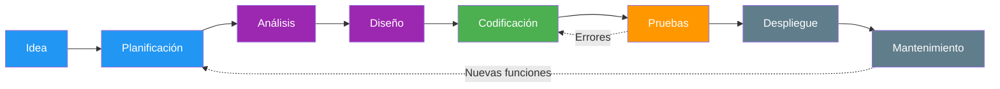

<TipBox type="truco" title="Dato curioso">

El término **«bug»** (bicho) nace en 1947, cuando **Grace Hopper** encontró una polilla real atascada en un relé del ordenador Harvard Mark II.

</TipBox>

---

## 🏠 ¿Por qué no podemos «saltarnos» pasos?

¿Empezarías a colocar ladrillos sin planos, sin saber dónde van las tuberías ni calcular los cimientos? Con el software pasa lo mismo.

<div class="grid grid-cols-2 gap-5 items-start">
<div>

| Etapa omitida | Consecuencia típica |
|---------------|---------------------|
| Sin planificación | El proyecto se queda sin presupuesto a medias |
| Sin análisis | El software no responde a lo que necesita el cliente |
| Sin diseño | Código desorganizado, difícil de mantener |
| Sin pruebas | Errores que el usuario descubre en producción |
| Sin documentación | Nadie sabe cómo funciona el sistema |

</div>
<div>

<TipBox type="advertencia">

Muchos estudiantes creen que «programar» es lo más importante. **Programar es solo UNA fase.** Quien no sabe analizar requisitos o diseñar estructuras de datos crea código inútil, aunque funcione técnicamente.

</TipBox>

</div>
</div>

---

## 🍳 Programar no es lo mismo que desarrollar

<div class="grid grid-cols-2 gap-5 items-start">
<div>

| Concepto | Qué es | Ejemplo |
|----------|--------|---------|
| **Programar** | Escribir código que hace algo específico | Una función que suma dos números |
| **Desarrollar software** | Todo el proceso: analizar, diseñar, codificar, probar y mantener | Una app de pedidos como Glovo desde cero |

</div>
<div>

<TipBox type="analogia">

Programar es saber **cocinar un plato**. Desarrollar software es **montar un restaurante**: recetas (código), pero también local (infraestructura), personal (equipo), permisos (documentación) y estrategia de negocio (planificación).

</TipBox>

</div>
</div>

---

## 📜 Script, programa y proyecto

No todo lo que se escribe tiene el mismo tamaño ni la misma organización:

| Término | Definición | Ejemplo |
|---------|------------|---------|
| **Script** | Programa pequeño y rápido para automatizar una tarea simple | Un script Python que renombra archivos |
| **Programa** | Conjunto de instrucciones que realizan una tarea concreta | La calculadora de Windows |
| **Proyecto de software** | Esfuerzo organizado, con planificación, equipo y fases definidas, para crear un sistema completo | Una plataforma de comercio electrónico |

---

## ⚖️ La regla del 80/20

En desarrollo de software se cumple una regla no escrita:

<div class="grid grid-cols-2 gap-5 items-start">
<div>

<ConceptCard icon="🔧" title="80% del tiempo" accent="red">

Se dedica a **mantenimiento y evolución** del software ya creado.

</ConceptCard>

</div>
<div>

<ConceptCard icon="🌱" title="20% del tiempo" accent="green">

Corresponde al **desarrollo inicial** del proyecto.

</ConceptCard>

</div>
</div>

<TipBox type="nota">

Por eso es crucial hacer las cosas bien desde el principio. En DAW practicarás cada fase del ciclo de vida, y las **prácticas en empresa (FEE)** te dejarán ver el ciclo completo en proyectos reales.

</TipBox>

---

## 🌍 ¿Y si no existiera el software?

<div class="grid grid-cols-2 gap-5 items-start">
<div>

Imagina tu móvil sin aplicaciones, tu ordenador sin sistema operativo o tu coche sin programación.

<TipBox type="analogia">

El hardware sin software es **un ladrillo caro**. El desarrollo de software crea la parte inteligente que hace útiles los dispositivos físicos.

</TipBox>

</div>
<div>

<RealExample app="Netflix">

Netflix es mucho más que una web para ver series: algoritmos de recomendación, streaming que se adapta a tu velocidad, infraestructura en la nube y apps para móvil, TV y consolas. Cada pieza pasa por todas las fases del ciclo de vida, y por eso puede desplegar cientos de veces al día sin que todo se rompa.

</RealExample>

</div>
</div>

---

## Resumen del punto 1

<div class="grid grid-cols-2 gap-5 items-start">
<div>

| Concepto | Descripción |
|----------|-------------|
| **Desarrollo de software** | Todo el proceso: de la idea al programa funcionando |
| **Ingeniería del software** | Especificar, diseñar y desarrollar con rigor |
| **Programar** | Solo una fase del proceso |
| **Script / programa / proyecto** | De tarea rápida a sistema completo |
| **Saltarse pasos** | Lleva a errores, sobrecostes y código inmantenible |
| **Regla 80/20** | 80% mantenimiento, 20% desarrollo inicial |

</div>
<div>

<ConceptCard icon="✅" title="Buenas prácticas" accent="green">

- Aprende el proceso, no solo la sintaxis
- Documenta desde el primer día el «por qué» de tus decisiones
- Usa Git aunque sea un ejercicio pequeño
- Practica con proyectos reales, no solo teoría

</ConceptCard>

<div class="mt-3">

**⏭️ ¿Qué viene después?** En el **punto 2** veremos la relación entre software y hardware, y cómo se comunican entre sí.

</div>

</div>
</div>

---
layout: section
---

<div class="ud-section-number">02</div>

# Conceptos fundamentales: software y hardware

<div class="opacity-70">La parte lógica y la parte física</div>

---

## 2 · Punto de partida

<div class="grid grid-cols-2 gap-5 items-start">
<div>

<TipBox type="consejo" title="Punto de partida">

¿Alguna vez te has preguntado por qué tu **móvil** funciona, mientras que un **ladrillo del mismo tamaño** no hace nada? La diferencia está en el software.

</TipBox>

<TipBox type="analogia">

**El hardware es el cuerpo humano** (órganos, huesos, músculos) **y el software es la mente:** sin cuerpo no hay dónde «vivir», pero sin mente no hay acciones ni decisiones.

</TipBox>

</div>
<div>

<Objetivos
  :items="[
    'Diferenciar entre software y hardware',
    'Identificar los componentes principales del sistema informático',
    'Comprender la relación entre software y hardware',
    'Reconocer los tipos de software según su función',
  ]"
/>

</div>
</div>

---

## 💾 ¿Qué es el software?

El **software** es la parte intangible o lógica de un sistema informático: el conjunto de programas que actúan sobre el hardware para ejecutar lo que el usuario desee.

<div class="grid grid-cols-3 gap-4 items-stretch">

<ConceptCard icon="🎯" title="Tiene una tarea" accent="blue">

Se desarrolla para llevar a cabo una **tarea determinada**.

</ConceptCard>

<ConceptCard icon="🗣️" title="Habla con el hardware" accent="purple">

Se comunica con él y le **indica qué hacer**.

</ConceptCard>

<ConceptCard icon="🔄" title="Traduce al usuario" accent="green">

Se encarga de **traducir** las instrucciones de los usuarios.

</ConceptCard>

</div>

<TipBox type="analogia">

Sin cuerpo no hay dónde «vivir», pero sin mente no hay acciones ni decisiones: **el software es lo que hace útil al hardware**.

</TipBox>

---

## 🧱 Software de sistema: la base de todo

Es el software base que debe estar instalado y configurado para que las aplicaciones puedan ejecutarse. Incluye el **sistema operativo** y los **drivers** (controladores de dispositivos).

<div class="grid grid-cols-2 gap-5 items-start">
<div>

**Ejemplos en tu día a día:**

- 🪟 Windows 11, macOS, Ubuntu Linux (sistemas operativos)
- 🎮 Controladores de tu tarjeta gráfica NVIDIA/AMD
- 🖨️ Drivers de tu impresora HP o Canon

</div>
<div>

<RealExample app="Windows">

¿Has actualizado Windows y tu impresora ha dejado de funcionar? Es un problema de **driver**: el sistema operativo cambió y el controlador necesita actualizarse para entender las nuevas órdenes. Por eso los fabricantes publican drivers periódicamente.

</RealExample>

</div>
</div>

---

## 📱 Software de aplicación: lo que usas a diario

Conjunto de programas con una **finalidad más o menos concreta**: ofimática, navegadores, editores de imagen, reproductores de música, videojuegos...

<div class="grid grid-cols-2 gap-5 items-start">
<div>

- 📝 Microsoft Word, Google Docs (procesamiento de textos)
- 📊 Excel (hojas de cálculo)
- 🌐 Chrome, Firefox, Edge (navegadores)

</div>
<div>

- 🎨 Photoshop, GIMP (edición de imagen)
- 🎵 Spotify, Netflix (entretenimiento)
- 💬 WhatsApp, Telegram (mensajería)

</div>
</div>

---

## 🛠️ Software de desarrollo: tus herramientas

Es el conjunto de herramientas que permiten **desarrollar programas**: editores, compiladores, intérpretes, entre otros.

<div class="grid grid-cols-2 gap-5 items-start">
<div>

**Herramientas que usarás en DAW:**

- 🧑‍💻 JetBrains Rider, Visual Studio Code, IntelliJ IDEA (editores/IDE)
- ⚙️ GCC, Clang (compiladores de C/C++)
- 🐍 Intérprete de Python
- 🌿 Git (control de versiones)

</div>
<div>

<TipBox type="consejo">

Estas herramientas también son software: **software que sirve para crear más software**. En el punto 7 las veremos con detalle.

</TipBox>

</div>
</div>

---

## 🎯 A medida o estándar: según la personalización

<div class="grid grid-cols-2 gap-5 items-start">
<div>

<ConceptCard icon="🧵" title="Software a medida" accent="purple">

Se desarrolla según los requisitos de una empresa. Se adapta a necesidades concretas, pero necesita tiempo, puede traer errores iniciales y **cuesta más**.

- Gestión de inventarios de un supermercado
- Citas médicas de un hospital
- Contabilidad adaptada a la legislación española

</ConceptCard>

</div>
<div>

<ConceptCard icon="📦" title="Software estándar" accent="blue">

Genérico, válido para cualquier cliente. Se compra hecho, está más probado y es **más barato**, pero puede traer funciones que nunca usarás o carecer de otras.

- SAP (gestión empresarial)
- Salesforce (CRM)
- Microsoft Dynamics (ERP)

</ConceptCard>

</div>
</div>

---

## 🧰 En DAW harás las dos cosas

<div class="grid grid-cols-2 gap-5 items-start">
<div>

<TipBox type="nota">

En DAW vais a crear **software a medida** (prácticas y proyectos) y a **integrar soluciones estándar** (usando APIs, conectando con bases de datos existentes...). Ambos enfoques son valiosos en la industria.

</TipBox>

</div>
<div>

| Tipo | Se hace | Ventaja |
|------|---------|---------|
| **A medida** | Desde cero | Encaja justo |
| **Estándar** | Se integra | Barato y probado |

</div>
</div>

---

## 🔩 ¿Qué es el hardware?

El **hardware** es el conjunto de dispositivos físicos que forman un ordenador. Los componentes principales:

<div class="grid grid-cols-3 gap-4 items-stretch">

<ConceptCard icon="🧠" title="CPU" accent="blue">

Procesador o microprocesador. **Lee y ejecuta** las instrucciones almacenadas en la RAM.

</ConceptCard>

<ConceptCard icon="⚡" title="Memoria RAM" accent="green">

Guarda de forma **temporal** el código de los programas. Es **volátil**: al apagar, se borra.

</ConceptCard>

<ConceptCard icon="🔐" title="Memoria ROM" accent="yellow">

Guarda de forma **permanente** las instrucciones para arrancar. Es de **solo lectura**.

</ConceptCard>

</div>

---

## 🔐 ROM y firmware: lo que arranca el equipo

La ROM contiene el **firmware** (BIOS o UEFI): un programa grabado en la placa madre.

<div class="grid grid-cols-2 gap-5 items-start">
<div>

<div class="ud-mer-angosto">

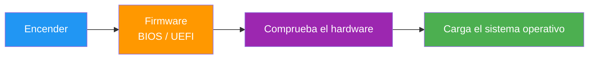

</div>

</div>
<div>

Se ejecuta al encender el equipo y comprueba que todo funcione **antes** de cargar el sistema operativo.

<TipBox type="nota">

No se puede modificar ni borrar durante el uso normal del equipo: por eso se llama memoria de **solo lectura**.

</TipBox>

</div>
</div>

---

## 💽 Disco duro y periféricos de entrada/salida

<div class="grid grid-cols-2 gap-5 items-start">
<div>

<ConceptCard icon="💽" title="Disco duro" accent="yellow">

Guarda de forma **permanente** los archivos ejecutables y los de datos. Se considera un periférico de **E/S**.

</ConceptCard>

</div>
<div>

<ConceptCard icon="🖱️" title="Periféricos de E/S" accent="purple">

Permiten la **comunicación** entre el usuario y el ordenador.

- **Entrada:** teclado, ratón, micrófono, cámara, escáner
- **Salida:** pantalla, altavoces, impresora, auriculares
- **Entrada/salida:** pendrive, disco externo, tarjeta de red, pantalla táctil

</ConceptCard>

</div>
</div>

---

## 🍳 La metáfora de la cocina

| Componente | Analogía culinaria | Función |
|------------|--------------------|---------|
| **CPU** | Chef | Ejecuta las tareas y procesa la información |
| **RAM** | Encimera de trabajo | Espacio temporal para trabajar |
| **ROM** | Receta de la casa | Instrucciones permanentes para arrancar |
| **Disco duro** | Nevera/armario | Almacenamiento permanente |
| **Periféricos E/S** | Ventanilla de pedidos y platos servidos | Comunicación con el usuario |

<TipBox type="consejo">

La CPU solo entiende **código binario** (0 y 1). Cada instrucción que escribes se traduce a millones de pulsos eléctricos que procesa a miles de millones por segundo (**gigahercios**).

</TipBox>

---

## ⚠️ Hardware no es «lo que se ve», software no es «solo apps»

<div class="grid grid-cols-2 gap-5 items-start">
<div>

<TipBox type="advertencia">

No confundas **hardware** con «dispositivo físico» ni **software** con «aplicación». El hardware incluye componentes internos que nunca ves, y el software incluye sistemas operativos y drivers, no solo apps.

</TipBox>

</div>
<div>

<TipBox type="consejo" title="Reflexión">

Abre tu móvil. ¿Cuántos componentes de **hardware** identificas (pantalla, batería, cámara, altavoz...)? ¿Y cuántos de **software** (sistema operativo, apps, fotos, contactos...)?

</TipBox>

</div>
</div>

---

## ⚖️ Software frente a hardware

Existe una relación indisoluble: ambos necesitan estar instalados y configurados para que el equipo funcione.

| Característica | Software | Hardware |
|----------------|----------|----------|
| **Naturaleza** | Intangible (programas, datos) | Físico (dispositivos) |
| **Ejemplos** | Windows, Word, Chrome | CPU, RAM, disco duro |
| **Se deteriora** | No (se copia perfectamente) | Sí (se desgasta) |
| **Se puede robar** | Sí (copia ilegal) | Sí (robo físico) |
| **Depende de** | Hardware para ejecutarse | Software para funcionar |
| **Se mide en** | MB, GB, líneas de código | GHz, MB, TB |

---

## 🎼 El sistema operativo: el director de orquesta

El **sistema operativo** coordina el hardware y actúa de intermediario con las aplicaciones, de forma «oculta» para ellas y para el usuario.

<div class="grid grid-cols-2 gap-5 items-start">
<div>

<TipBox type="analogia">

Los músicos (hardware) pueden tocar solos, pero necesitan al **director** (SO) para tocar juntos, al mismo ritmo, y producir una sinfonía coherente.

</TipBox>

</div>
<div>

**Funciones del sistema operativo:**

- ⚙️ **Procesos:** ¿qué programa se ejecuta ahora?
- 🧮 **Memoria:** ¿cuánta RAM usa cada programa?
- 📁 **Archivos:** ¿dónde se guardan los datos?
- 🖨️ **Dispositivos:** ¿cómo habla con la impresora?
- 🔒 **Seguridad:** ¿quién accede a qué?

</div>
</div>

---

## 🔤 Las aplicaciones y el código binario

Una aplicación es un conjunto de programas escritos en un lenguaje de programación. Las personas lo entendemos; el hardware **no**.

<div class="grid grid-cols-2 gap-5 items-start">
<div>

El hardware solo interpreta **señales eléctricas** (ausencia o presencia de tensión) que se traducen en secuencias de **0 y 1**. Por eso el código debe pasar por un **proceso de traducción**.

</div>
<div>

<TipBox type="truco" title="Dato curioso">

El código máquina de un procesador Intel i9 tiene **más de 3.000 instrucciones** distintas. Al programar en Python o Java usas abstracciones que ocultan esa complejidad.

</TipBox>

</div>
</div>

---

## 🌉 El puente hardware-software

<div class="grid grid-cols-2 gap-5 items-start">
<div>


</div>
<div>

<div class="ud-mer-angosto">

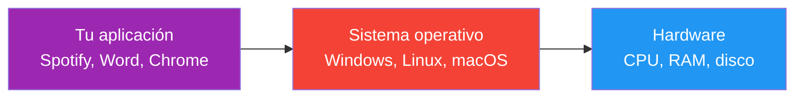

</div>

</div>
</div>

---

## 🔁 Mismo programa, distinto sistema

<div class="grid grid-cols-2 gap-5 items-start">
<div>

<TipBox type="nota">

Esta separación permite ejecutar el mismo programa (por ejemplo, **Visual Studio Code**) en Windows, Linux o macOS. El código es el mismo, pero el sistema operativo traduce tus órdenes a las señales de cada hardware.

</TipBox>

</div>
<div>

<TipBox type="consejo" title="Dato profesional">

Necesitarás esta relación para **diagnosticar problemas**: un error puede ser de software (un bug) o de hardware (falta de memoria, disco lleno).

</TipBox>

</div>
</div>

---

## Resumen del punto 2

<div class="grid grid-cols-2 gap-5 items-start">
<div>

| Concepto | Descripción |
|----------|-------------|
| **Software** | Parte lógica: sistema, aplicaciones y desarrollo |
| **Hardware** | Parte física: CPU, RAM, disco, periféricos |
| **A medida / estándar** | Hecho para un cliente / genérico para todos |
| **RAM / ROM** | Temporal y volátil / permanente y de solo lectura |
| **Sistema operativo** | Intermediario que gestiona los recursos |
| **Relación** | Uno necesita al otro para funcionar |

</div>
<div>

<ConceptCard icon="✅" title="Buenas prácticas" accent="green">

- Mide con el Administrador de tareas o `htop` antes de comprar hardware
- Optimiza primero: cierra procesos y actualiza drivers
- Si el disco es un HDD lento, un SSD marca la diferencia
- Para desarrollo pesado, 16-32 GB de RAM y SSD

</ConceptCard>

<div class="mt-3">

**⏭️ ¿Qué viene después?** En el **punto 3** veremos el **ciclo de vida del software**: cómo se crea el software que se ejecuta en este hardware.

</div>

</div>
</div>

---
layout: section
---

<div class="ud-section-number">03</div>

# El ciclo de vida del desarrollo de software

<div class="opacity-70">Las fases por las que pasa todo programa</div>

---

## 3 · Punto de partida

<div class="grid grid-cols-2 gap-5 items-start">
<div>

<TipBox type="consejo" title="Punto de partida">

¿Te has preguntado por qué algunos proyectos de software **triunfan** y otros **fracasan estrepitosamente**? La diferencia suele estar en si siguen un proceso estructurado o improvisan sobre la marcha.

</TipBox>

<TipBox type="analogia">

**El ciclo de vida del software es como el de una persona:** nace (se concibe la idea), crece (se desarrolla), se reproduce (se mantiene y evoluciona) y eventualmente muere (se retira).

</TipBox>

</div>
<div>

<Objetivos
  :items="[
    'Definir qué es el ciclo de vida del software',
    'Identificar y describir las fases principales del desarrollo',
    'Comprender la importancia de cada fase',
    'Reconocer los tipos de mantenimiento de software',
  ]"
/>

</div>
</div>

---

## 🔄 El ciclo de vida del software

La serie de pasos a seguir para desarrollar un programa es lo que se conoce como **ciclo de vida del software**.

<div class="grid grid-cols-2 gap-5 items-start">
<div>

<TipBox type="analogia">

Cada etapa tiene sus propias necesidades y cuidados, igual que las etapas de la vida de una persona.

</TipBox>

</div>
<div>

<TipBox type="nota">

Es un proceso que puede parecer muy complejo y exige una gran **coordinación y disciplina** del grupo que lo desarrolla.

</TipBox>

</div>
</div>

---

## 📉 ¿Por qué seguir un ciclo de vida?

Sin un ciclo de vida estructurado, los proyectos suelen fracasar. Según estudios de la industria:

<div class="grid grid-cols-3 gap-4 items-stretch">

<ConceptCard icon="💥" title="70% fracasan" accent="red">

Proyectos sobrecostados, tardíos o que no cumplen los requisitos.

</ConceptCard>

<ConceptCard icon="💸" title="10-100 veces más" accent="yellow">

Es lo que cuesta un error de las **fases tempranas** si se descubre tarde.

</ConceptCard>

<ConceptCard icon="🔧" title="60-80% del coste" accent="blue">

Es lo que representa el **mantenimiento** sobre el coste total del software.

</ConceptCard>

</div>

<TipBox type="nota">

En tus prácticas de DAW trabajarás el ciclo de vida completo. Si entregas código sin haberlo analizado, estás **«construyendo sin planos»**.

</TipBox>

---

## 🗺️ Las nueve fases del desarrollo

<div class="grid grid-cols-2 gap-5 items-start">
<div>


</div>
<div>

1. **Planificación** · 2. **Análisis** · 3. **Diseño**
4. **Codificación** · 5. **Pruebas** · 6. **Documentación**
7. **Explotación** · 8. **Mantenimiento** · 9. **Retirada**

<TipBox type="advertencia">

Las fases **no** son secuenciales en todos los modelos. En las metodologías ágiles, por ejemplo, se repiten en cada iteración (**sprint**).

</TipBox>

</div>
</div>

---

## 1️⃣ Planificación: ¿merece la pena?

Se establecen los **objetivos**, se define el **alcance** y se hace un **estudio de viabilidad y costes**. Es la fase más compleja y precisa expertos en planificación.

<div class="grid grid-cols-2 gap-5 items-start">
<div>

<ConceptCard icon="❓" title="Preguntas clave" accent="blue">

- ¿Qué queremos lograr?
- ¿Es técnicamente posible?
- ¿Tenemos tiempo, dinero y personal?
- ¿Cuánto costará y cuándo estará listo?

</ConceptCard>

</div>
<div>

<ConceptCard icon="📄" title="Documentos típicos" accent="purple">

- Acta de constitución del proyecto
- Estudio de viabilidad
- Estimación de costes y plazos

</ConceptCard>

</div>
</div>

---

## 📸 Planificación en la vida real

<div class="grid grid-cols-2 gap-5 items-start">
<div>

<RealExample app="Instagram">

Antes de desarrollar Instagram, sus fundadores se preguntaron: «¿la gente quiere compartir fotos con filtros?». «Sí, pero necesitamos servidores baratos y una app ligera». Sin este análisis, habrían invertido millones en un producto que nadie quería.

</RealExample>

</div>
<div>

<TipBox type="consejo">

Una buena planificación evita gastar tiempo y dinero en algo **inviable** o que **nadie necesita**.

</TipBox>

</div>
</div>

---

## 2️⃣ Análisis: el «qué» del software

Es la fase **más importante**: todo lo demás depende de lo bien detallada que esté. Se determinan las **necesidades del cliente** y se especifican los **requisitos**.

<div class="grid grid-cols-2 gap-5 items-start">
<div>

Lo fundamental es una buena **comunicación** entre el analista y el cliente, para saber **qué** hace nuestro software. No está automatizada: depende mucho del analista.

</div>
<div>

<TipBox type="nota">

**«No asumas nada».** Si el cliente dice «quiero una tienda online», pregunta: ¿qué productos? ¿pago con tarjeta? ¿incluye IVA? ¿qué pasa si no hay stock? ¿qué estadísticas quieres ver?

</TipBox>

</div>
</div>

---

## 📋 Especificación de requisitos

Una buena **especificación de requisitos** debe cumplir ocho condiciones:

<div class="grid grid-cols-2 gap-5 items-start">
<div>

- ✅ Ser **completa** y sin omisiones
- ✂️ Ser **concisa** y sin trivialidades
- 🔍 Evitar **ambigüedades** (lenguaje formal)
- 🚫 Evitar detalles de diseño o implementación

</div>
<div>

- 👤 Ser entendible por el **cliente**
- ↔️ Separar requisitos **funcionales** y **no funcionales**
- 🪜 Dividir y **jerarquizar** el modelo
- 🧪 Fijar criterios de **validación**

</div>
</div>

---

## 🧩 Tipos de requisitos

<div class="grid grid-cols-3 gap-4 items-stretch">

<ConceptCard icon="⚙️" title="Funcionales" accent="blue">

Qué **funciones** realizará la aplicación y cómo se comportará ante entradas y situaciones inesperadas.

</ConceptCard>

<ConceptCard icon="📏" title="No funcionales" accent="purple">

**Calidad** del sistema: tiempos de respuesta, legislación aplicable, simultaneidad de peticiones...

</ConceptCard>

<ConceptCard icon="🔄" title="De información" accent="green">

Qué información se ofrece como **salida** y qué datos son necesarios como **entrada**.

</ConceptCard>

</div>

---

## 🛒 Requisitos de una tienda online

<div class="grid grid-cols-2 gap-5 items-start">
<div>

**Funcionales:**

| ID | Requisito | Prioridad |
|----|-----------|-----------|
| RF-01 | Registrar nuevos usuarios | Alta |
| RF-02 | Mostrar el catálogo | Alta |
| RF-03 | Buscar por categoría | Media |
| RF-04 | Email de confirmación tras la compra | Alta |

</div>
<div>

**No funcionales:**

- **RNF-01:** responderá en menos de 2 segundos
- **RNF-02:** soportará 1000 usuarios simultáneos
- **RNF-03:** cumplirá el RGPD con los datos personales

</div>
</div>

---

## 📑 La ERS: el contrato con el cliente

La culminación del análisis es la **Especificación de Requisitos del Software (ERS)**, que actúa como un **contrato** entre el cliente y el desarrollador.

<div class="grid grid-cols-2 gap-5 items-start">
<div>

<TipBox type="nota">

Ejemplo de requisito de información: *el sistema recibirá DNI, nombre y dirección; generará una factura con fecha, productos, subtotal, IVA y total.*

</TipBox>

<TipBox type="nota">

En DAW harás ERS simplificados. Uno real puede tener **más de 50 páginas**: lo clave es que sea claro, completo y sin ambigüedades.

</TipBox>

</div>
<div>

<TipBox type="advertencia">

No confundas requisitos **funcionales** (qué hace) con requisitos de **diseño** (cómo lo hace). «Guardará los datos en PostgreSQL» es un **detalle de implementación**, no un requisito funcional.

</TipBox>

</div>
</div>

---

## 3️⃣ Diseño: el «cómo» del software

Una vez que se sabe **qué** hay que hacer, se define **cómo** hacerlo: se descompone el sistema en componentes que pueden desarrollarse por separado.

<div class="grid grid-cols-2 gap-5 items-start">
<div>

**Actividades habituales:**

- 🏛️ Diseño arquitectónico → *Documento de arquitectura*
- 🔬 Diseño detallado → *Especificación de módulos y funciones*
- 🗄️ Diseño de datos (entidades, relaciones, SGBD)
- 🖼️ Diseño de la interfaz de usuario

</div>
<div>

**Artefactos típicos:**

- Diagramas UML (clases, secuencia, casos de uso)
- Modelo entidad-relación
- Maquetas de interfaz
- Especificación de APIs

<TipBox type="analogia">

Análisis: «una casa de 3 habitaciones con jardín». Diseño: «la cocina aquí, el salón de 30 m², ladrillo caravista...».

</TipBox>

</div>
</div>

---

## 4️⃣ Codificación: de los planos al código

Se traducen los resultados del diseño a un **lenguaje de programación**. Esta tarea la realiza el programador y debe cumplir exhaustivamente lo impuesto en el análisis y el diseño. El resultado es el **código fuente**.

<div class="grid grid-cols-5 gap-3 items-stretch text-sm">

<ConceptCard icon="🧩" title="Modular" accent="blue">

Dividido en trozos pequeños.

</ConceptCard>

<ConceptCard icon="✔️" title="Correcto" accent="green">

Hace lo que se le pide.

</ConceptCard>

<ConceptCard icon="📖" title="Legible" accent="purple">

Fácil de mantener.

</ConceptCard>

<ConceptCard icon="⚡" title="Eficiente" accent="yellow">

Buen uso de recursos.

</ConceptCard>

<ConceptCard icon="🚚" title="Portable" accent="red">

Válido en cualquier equipo.

</ConceptCard>

</div>

---

## 👩‍💻 Programar no es solo escribir código

Un buen programador:

<div class="grid grid-cols-2 gap-5 items-start">
<div>

- 📚 **Lee** código ajeno más que escribe el propio
- 📐 Sigue **convenciones** y estándares
- 💬 Comenta el **«por qué»**, no el «qué»

</div>
<div>

- 🌿 Usa control de versiones (**Git**)
- 👀 Pide **revisiones de código** (*code review*)

<TipBox type="nota">

Durante esta fase el código pasa por tres estados: **fuente, objeto y ejecutable** (punto 6).

</TipBox>

</div>
</div>

---

## 5️⃣ Pruebas: buscar los fallos

El objetivo de las **pruebas** es descubrir y corregir defectos: el programa debe someterse al máximo número de situaciones diferentes.

<div class="grid grid-cols-2 gap-5 items-start">
<div>

<ConceptCard icon="🛠️" title="Verificación" accent="blue">

**¿Hacemos el producto bien?** Comprueba que el código cumple las especificaciones técnicas.

</ConceptCard>

</div>
<div>

<ConceptCard icon="🎯" title="Validación" accent="purple">

**¿Hacemos el producto correcto?** Comprueba que satisface las necesidades reales del usuario.

</ConceptCard>

</div>
</div>

<TipBox type="consejo">

Un cajero puede **verificar** que su código funciona, pero si el usuario no sabe usarlo por un diseño confuso, no está **validado**. Y recuerda: *si no has encontrado un bug, es que no has probado lo suficiente.*

</TipBox>

---

## 🧪 Tipos de pruebas

| Tipo | Qué prueba | Ejemplo |
|------|------------|---------|
| **Unitarias** | Cada parte por separado | Una función que suma devuelve el resultado correcto |
| **De integración** | El sistema con todas sus partes | El login se conecta con la base de datos de usuarios |
| **Funcionales** | Que hace lo que debe, con el cliente | Con cuenta y login, ve su panel de control |
| **Estructurales** | Estrés, carga... | ¿Cuántos usuarios simultáneos aguanta el servidor? |
| **Beta test** | El entorno real del cliente | Uso normal en su empresa |

---

## 🎬 Pruebas en la vida real

<div class="grid grid-cols-2 gap-5 items-start">
<div>

<RealExample app="Netflix">

Netflix prueba nuevas funciones con un **1% de usuarios** antes de lanzarlas globalmente. Si detecta problemas, corrige y prueba con otro 1%. Así minimiza el riesgo de un fallo masivo.

</RealExample>

</div>
<div>

**Resultados de las pruebas:**

- Unitarias → **módulos utilizables**
- Integración → **sistema utilizable**
- Del sistema → **sistema aceptado**

<TipBox type="nota">

Hacer *testing* **no es opcional**: es parte del trabajo profesional.

</TipBox>

</div>
</div>

---

## 6️⃣ Documentación: que nada se pierda

Todas las etapas deben quedar documentadas. Una buena documentación permite **reutilizar** programas en otras aplicaciones.

| Documento | Dirigido a | Contenido típico |
|-----------|------------|------------------|
| **Guía técnica** | Analistas y programadores | Arquitectura, diccionario de datos, despliegue |
| **Guía de uso** | Usuarios finales | Capturas, tutoriales, preguntas frecuentes |
| **Guía de instalación** | Personal informático | Requisitos, pasos, configuración, problemas |

<TipBox type="advertencia">

*Sin documentación, el código es tan útil como un contrato en un idioma que no entiendes.*

</TipBox>

---

## 7️⃣ Explotación: llega al usuario

Los usuarios finales conocen la aplicación y empiezan a usarla: se **instala, configura y verifica** en el equipo del cliente. Es un momento crítico: hay que tenerlo todo preparado.

<div class="grid grid-cols-2 gap-5 items-start">
<div>

**Términos relacionados:**

- 🚀 **Deploy:** despliegue en producción
- 🏷️ **Release:** nueva versión para los usuarios
- 🌍 **Entorno de producción:** donde usan el sistema los usuarios reales

</div>
<div>

<TipBox type="truco" title="Dato">

Con **DevOps**, el despliegue puede ser automático (**CI/CD**). Netflix despliega cientos de veces al día sin intervención humana.

</TipBox>

</div>
</div>

---

## 8️⃣ Mantenimiento: la fase más larga

Es el proceso de **control, mejora y optimización** del software. Siempre surgen errores y nuevas versiones, y el software debe adaptarse al hardware y a nuevas situaciones.

| Tipo | Pregunta clave | Ejemplo |
|------|----------------|---------|
| **Correctivo** | ¿Qué está roto? | El botón de login falla en Firefox |
| **Perfectivo** | ¿Qué puede mejorar? | Errores del formulario en tiempo real |
| **Evolutivo** | ¿Qué falta? | Añadir pago con PayPal |
| **Adaptativo** | ¿Dónde debe funcionar? | Compatible con iOS 17 |

<TipBox type="nota">

Al heredar código ajeno, el **80%** de tu trabajo será mantenimiento. Los resultados: informes de errores y control de cambios.

</TipBox>

---

## 9️⃣ Retirada: el final de la vida útil

Ocurre cuando ya **no resulta rentable** seguir ampliando o manteniendo el software. El ciclo puede empezar de nuevo, comprando o desarrollando otro.

<div class="grid grid-cols-2 gap-5 items-start">
<div>

**Señales de que debe retirarse:**

- Los costes de mantenimiento superan los beneficios
- El hardware ya no es compatible
- Las tecnologías están obsoletas
- No cumple nuevas regulaciones legales

</div>
<div>

**Ejemplos reales:**

- 🪟 **Windows XP:** soporte terminado en 2014; muchas empresas lo usaron hasta 2019
- ⚡ **Flash Player:** Adobe lo discontinuó en 2020 por seguridad
- 👥 **MySpace:** fue la mayor red social; hoy casi abandonada

</div>
</div>

---

## 🧮 Mini-proyecto: calculadora de calificaciones

Vamos a seguir las **9 fases** con un proyecto sencillo: una app de consola en C# que calcula la media de un alumno.

<div class="grid grid-cols-2 gap-5 items-start">
<div>

<ConceptCard icon="1️⃣" title="Fase 1 · Planificación" accent="blue">

- **Objetivo:** media de 3 notas y mostrar si aprueba
- **Viabilidad:** C# de consola, un programador, 1 día
- **Coste:** 0 € (proyecto de aprendizaje)

</ConceptCard>

</div>
<div>

<ConceptCard icon="2️⃣" title="Fase 2 · Análisis" accent="purple">

- **Funcional:** introducir 3 notas, calcular la media y mostrar *Aprobado* (≥5) o *Suspenso* (<5)
- **No funcional:** respuesta instantánea y mensajes en español
- **ERS:** entrada 3 decimales; salida media + texto

</ConceptCard>

</div>
</div>

---

## 📐 Fase 3: el diseño sobre el papel

Antes de escribir código en serio, decides cómo se organiza el programa. Este esqueleto usa nombres como `PedirNota` o `CalcularMedia` sin entrar en cómo funcionan: eso es lo que da de sí el diseño.

```csharp
// Diseño de la estructura
double nota1 = PedirNota("Primera nota");
double nota2 = PedirNota("Segunda nota");
double nota3 = PedirNota("Tercera nota");
double media = CalcularMedia(nota1, nota2, nota3);
MostrarResultado(media);
```

---

## 💻 Fase 4: la codificación

Con el diseño en la mano, sustituyes los nombres inventados por instrucciones concretas de C# que la máquina entiende.

```csharp
Console.Write("Primera nota: ");
double nota1 = Convert.ToDouble(Console.ReadLine());
Console.Write("Segunda nota: ");
double nota2 = Convert.ToDouble(Console.ReadLine());
Console.Write("Tercera nota: ");
double nota3 = Convert.ToDouble(Console.ReadLine());

double media = (nota1 + nota2 + nota3) / 3;
Console.WriteLine($"Media: {media:F1}");

if (media >= 5)
    Console.WriteLine("Aprobado");
else
    Console.WriteLine("Suspenso");
```

---

## 🧪 Fase 5: las pruebas

| Prueba | Entrada | Salida esperada | Resultado |
|--------|---------|-----------------|-----------|
| Notas aprobadas | 7, 8, 6 | Media: 7.0, Aprobado | ✅ |
| Notas suspensas | 3, 4, 2 | Media: 3.0, Suspenso | ✅ |
| Nota límite | 5, 5, 5 | Media: 5.0, Aprobado | ✅ |
| Decimales | 6.5, 7.3, 8.1 | Media: 7.3, Aprobado | ✅ |

---

## 📝 Fases 6 y 7: documentar y explotar

<div class="grid grid-cols-2 gap-5 items-start">
<div>

Un programa sin documentación es un misterio incluso para su autor. Redactas las **instrucciones mínimas** de uso:

```markdown
# Calculadora de Calificaciones
## Uso
1. Ejecutar el programa
2. Introducir 3 notas
3. Ver la media y si se aprueba
```

</div>
<div>

Probado y documentado, toca **ponerlo a trabajar**. Aquí basta lanzarlo desde la consola:

```bash
dotnet run
```

Funciona en cualquier sistema operativo con **.NET** instalado.

</div>
</div>

---

## 🔧 Fases 8 y 9: mantener y retirar

<div class="grid grid-cols-2 gap-5 items-start">
<div>

<ConceptCard icon="8️⃣" title="Fase 8 · Mantenimiento" accent="yellow">

- **Evolutivo:** más de 3 notas (hasta que el usuario escriba «fin»)
- **Perfectivo:** mostrar la nota más alta y la más baja
- **Correctivo:** si escribe una letra en vez de un número, el programa falla: hay que validar

</ConceptCard>

</div>
<div>

<ConceptCard icon="9️⃣" title="Fase 9 · Retirada" accent="red">

Cuando el alumno ya no la necesite (o la mejore con una app web), se **retira** esta versión de consola.

</ConceptCard>

<TipBox type="nota">

Lo que aquí haces con 20 líneas, en una empresa se hace con **20.000** y un equipo de 10 personas.

</TipBox>

</div>
</div>

---

## 🧭 ¿Qué modelo de ciclo de vida elijo?

| Situación | Modelo recomendado |
|-----------|--------------------|
| Proyecto pequeño y requisitos claros | **Cascada**: simple y lineal |
| Requisitos que cambian a menudo (MVP) | **Scrum o Kanban**: valor cada 2 semanas |
| Seguridad crítica (banca, sanidad) | **Cascada o modelo en V**: documentación y pruebas |
| Equipo pequeño sin experiencia | **Scrum simplificado**, sprints de 1 semana |

<RealExample app="Spotify">

Usa un modelo híbrido: **Kanban** para el mantenimiento de infraestructura y **Scrum** para nuevas funcionalidades. Cada *squad* decide qué le funciona mejor: lo importante es que el proceso sea visible, repetible y mejorable.

</RealExample>

---

## Resumen del punto 3

<div class="grid grid-cols-2 gap-5 items-start">
<div>

| Fase | Resultado |
|------|-----------|
| **Planificación** | Estudio de viabilidad |
| **Análisis** | ERS (requisitos) |
| **Diseño** | Arquitectura y especificación |
| **Codificación** | Código fuente |
| **Pruebas** | Sistema aceptado |
| **Documentación** | Manuales |
| **Explotación** | Aplicación funcionando |
| **Mantenimiento** | Nuevas versiones |
| **Retirada** | Fin del ciclo |

</div>
<div>

<ConceptCard icon="✅" title="Buenas prácticas" accent="green">

- Cascada si es pequeño y claro; Scrum o Kanban si cambia
- No uses Scrum «porque está de moda»
- Si no sabes en qué fase estás, estás construyendo sin planos
- Documenta y prueba en cada fase

</ConceptCard>

<div class="mt-3">

**⏭️ ¿Qué viene después?** En el **punto 4** veremos los **modelos y metodologías**: cómo se organizan estas fases (cascada, ágil, Scrum, Kanban...).

</div>

</div>
</div>

---
layout: section
---

<div class="ud-section-number">04</div>

# Modelos y metodologías de desarrollo

<div class="opacity-70">Cómo se organizan las fases del proyecto</div>

---

## 4 · Punto de partida

<div class="grid grid-cols-2 gap-5 items-start">
<div>

<TipBox type="consejo" title="Punto de partida">

¿Por qué algunas empresas entregan el software **a tiempo** y otras **siempre se retrasan**? La diferencia está en el modelo de desarrollo que eligen.

</TipBox>

<TipBox type="analogia">

**Elegir un modelo es elegir cómo construir una casa:** no es lo mismo una cabaña en el bosque (requisitos claros) que un rascacielos en una ciudad (muchos cambios durante la obra).

</TipBox>

</div>
<div>

<Objetivos
  :items="[
    'Diferenciar entre modelos clásicos y ágiles',
    'Conocer las características de cada modelo',
    'Saber cuándo usar cada metodología',
    'Identificar los valores y principios del Manifiesto Ágil',
  ]"
/>

</div>
</div>

---

## 🧭 Un modelo para cada proyecto

Siempre se debe aplicar un **modelo de ciclo de vida** a cualquier proyecto software: es la serie de pasos a seguir para desarrollar un programa.

<div class="grid grid-cols-3 gap-4 items-stretch">

<ConceptCard icon="🏛️" title="Clásicos" accent="blue">

**Predictivos y rígidos:** cascada, en V. Conocemos todos los requisitos al inicio.

</ConceptCard>

<ConceptCard icon="🔁" title="Evolutivos" accent="purple">

**Por versiones:** prototipos, iterativo incremental y espiral.

</ConceptCard>

<ConceptCard icon="⚡" title="Ágiles" accent="green">

**Adaptativos:** Kanban, Scrum y XP. Aceptan el cambio.

</ConceptCard>

</div>

---

## 💧 Modelo en cascada

Es el modelo más antiguo: las fases se realizan **en orden** y el resultado de una es la entrada de la siguiente. Es secuencial y lineal.


<TipBox type="advertencia">

Es muy rígido y se adapta mal al cambio. Si te equivocas en el análisis y lo descubres en pruebas, tienes que **volver atrás y recodificar todo**: se multiplican los costes.

</TipBox>

---

## 🚀 Cascada: cuándo se usa

<div class="grid grid-cols-2 gap-5 items-start">
<div>

**Casos de uso:**

- Proyectos **pequeños** con requisitos muy claros desde el inicio
- Sistemas **críticos** donde no se puede cambiar nada (regulación, seguridad)
- Sistemas embebidos con requisitos fijos

</div>
<div>

<RealExample app="Apollo 11">

El sistema de control de la misión que llegó a la Luna en 1969 usó un enfoque similar a la cascada: no había margen para cambios una vez iniciado el proyecto.

</RealExample>

</div>
</div>

---

## ↩️ Cascada con realimentación

Variante que permite **volver atrás** en cualquier momento para corregir, modificar o depurar. Perfecta si el proyecto es rígido y los requisitos están claros.

<div class="grid grid-cols-2 gap-5 items-start">
<div>


</div>
<div>

- ✅ **Ventaja:** permite corregir sin empezar desde cero
- ⚠️ **Desventaja:** cada «vuelta atrás» cuesta tiempo y dinero

<TipBox type="consejo">

Si en pruebas se descubre un problema de diseño, se vuelve a la fase de **diseño** sin reiniciar todo el proyecto.

</TipBox>

</div>
</div>

---

## ✌️ Modelo en V

Muy parecido a la cascada, con una visión jerarquizada: los niveles superiores son más abstractos y los inferiores, más detallados.

<div class="grid grid-cols-2 gap-5 items-start">
<div>

| Desarrollo | Verificación |
|------------|--------------|
| Análisis | Pruebas de aceptación |
| Diseño arquitectónico | Pruebas de sistema |
| Diseño detallado | Pruebas de integración |
| Codificación | Pruebas unitarias |

</div>
<div>


</div>
</div>

---

## 🛡️ Modelo en V: la clave

<div class="grid grid-cols-2 gap-5 items-start">
<div>

<TipBox type="consejo" title="La clave">

Cada fase de desarrollo tiene una **fase de verificación paralela**. El diseño de pruebas empieza en el análisis, **no al final**: así se detectan antes los errores.

</TipBox>

<TipBox type="nota">

En DAW trabajaremos sobre todo con modelos **ágiles**, pero muchas empresas (en sectores regulados) aún usan los clásicos.

</TipBox>

</div>
<div>

**Casos de uso:**

- Sistemas críticos donde cada fase se verifica antes de avanzar
- Industria **aeroespacial, médica y nuclear**
- Proyectos con altos requisitos de calidad y seguridad

</div>
</div>

---

## 🎨 Prototipos: probar antes de construir

Se usa cuando los requisitos **no están claros**. Se crea un prototipo en el análisis, el cliente lo prueba y se refinan los requisitos; se repite las veces necesarias.

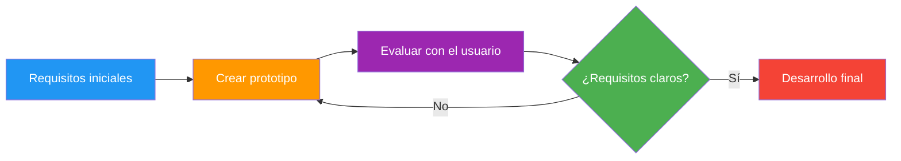

<TipBox type="analogia">

Es como dibujar **varios bocetos de un logo** antes de quedarte con el definitivo: cada prototipo refina lo que el cliente quiere.

</TipBox>

---

## 🧪 Tipos de prototipos

<div class="grid grid-cols-2 gap-5 items-start">
<div>

<ConceptCard icon="🗑️" title="Rápidos (throwaway)" accent="red">

Se desarrollan con otras herramientas y **se desechan**: solo validan requisitos.

*Ejemplo:* una maqueta en **Figma** de cómo quedará la interfaz, sin programar nada.

</ConceptCard>

</div>
<div>

<ConceptCard icon="🌱" title="Evolutivos" accent="green">

Se hacen con las herramientas del proyecto y **sirven de base** del producto.

*Ejemplo:* un **MVP** que se mejora con el feedback hasta ser el producto final.

</ConceptCard>

</div>
</div>

---

## ⚖️ Prototipos: ventajas y desventajas

<div class="grid grid-cols-2 gap-5 items-start">
<div>


</div>
<div>

**Ventajas:**

- Reduce el riesgo de malinterpretar requisitos
- El cliente ve resultados rápido
- Facilita la comunicación

**Desventajas:**

- El cliente puede creer que el prototipo **es** el producto
- Un prototipo «desechable» puede acabar reutilizándose (mala idea)

</div>
</div>

---

## 🔁 Modelos evolutivos o incrementales

Más modernos que los clásicos: tienen en cuenta que el software es **cambiante y evolutivo**. Se desarrolla una versión inicial, el usuario la comenta y se refina en versiones sucesivas.

<div class="grid grid-cols-2 gap-5 items-start">
<div>

<ConceptCard icon="🔂" title="Iterativo incremental" accent="blue">

Basado en la cascada con realimentación: las fases se **repiten y refinan**, propagando la mejora a las siguientes.

</ConceptCard>

</div>
<div>

<TipBox type="consejo">

Especificación, desarrollo y pruebas se ejecutan **en cada iteración**: así el usuario da feedback rápido.

</TipBox>

</div>
</div>

---

## 🌀 Modelo en espiral

Combina el iterativo incremental con la cascada. Se construye en **versiones cada vez mejores** y se centra en la **gestión de riesgos** en cada fase. Es bastante complejo.

<div class="grid grid-cols-2 gap-5 items-start">
<div>

1. **Objetivos:** qué se busca en la iteración
2. **Análisis de riesgos:** técnicos y de gestión
3. **Desarrollo y validación:** prototipos e implementación
4. **Planificación:** revisar y preparar la siguiente

</div>
<div>


</div>
</div>

---

## 🧗 Espiral: cuándo y quién

<div class="grid grid-cols-2 gap-5 items-start">
<div>

**Casos de uso:**

- Proyectos grandes con **alta incertidumbre**
- Requisitos que cambian con frecuencia
- Innovación y desarrollo de nuevos productos

</div>
<div>

<TipBox type="truco" title="Dato">

Lo propuso **Barry Boehm** (1986-1988) como respuesta a las limitaciones de la cascada. Fue de los primeros modelos en formalizar la **gestión de riesgos**.

</TipBox>

</div>
</div>

---

## ⚡ Metodologías ágiles

Basadas en el desarrollo **iterativo e incremental**: los requisitos y las soluciones evolucionan con el tiempo.

<div class="grid grid-cols-3 gap-4 items-stretch">

<ConceptCard icon="🤝" title="Colaboración" accent="blue">

Trabajo en equipo y colaboración con el **cliente**.

</ConceptCard>

<ConceptCard icon="🔄" title="Adaptación" accent="purple">

Adaptación al **cambio** en lugar de seguir un plan fijo.

</ConceptCard>

<ConceptCard icon="🧑‍🤝‍🧑" title="Autoorganización" accent="green">

Equipos **multidisciplinares** que toman decisiones a corto plazo.

</ConceptCard>

</div>

---

## 📜 El Manifiesto Ágil

Creado en **2001** por 17 desarrolladores frustrados con la rigidez de los métodos tradicionales. Tiene cuatro valores y doce principios.

| Valoramos más... | ...que |
|------------------|--------|
| **Individuos e interacciones** | Procesos y herramientas |
| **Software funcionando** | Documentación extensiva |
| **Colaboración con el cliente** | Negociación contractual |
| **Respuesta ante el cambio** | Seguir un plan |

<TipBox type="nota">

No dice que procesos, documentación, contratos y planes sean inútiles: dice que lo de la izquierda es **más valioso**.

</TipBox>

---

## 🗂️ Kanban: el sistema de tarjetas

Desarrollado por **Toyota** para fabricar los productos necesarios en la cantidad y el tiempo justos. Se basa en el *Lean manufacturing* y busca el máximo valor con los recursos justos.

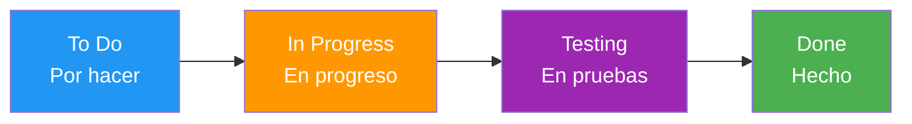

<TipBox type="consejo">

Herramientas con tableros Kanban: **Trello, Jira, Asana, Notion y Microsoft Planner**.

</TipBox>

---

## 📌 Los seis principios de Kanban

<div class="grid grid-cols-2 gap-5 items-start">
<div>

1. 👀 **Visualizar** el trabajo con un tablero de columnas
2. 🚧 **Limitar el trabajo en progreso (WIP)**
3. 🌊 **Gestionar el flujo** del trabajo

</div>
<div>

4. 📋 **Políticas explícitas**: reglas claras para todos
5. 🔁 **Ciclos de feedback**: revisiones regulares
6. 🤝 **Mejorar** de forma colaborativa

</div>
</div>

<TipBox type="advertencia" title="WIP">

Cada columna tiene un límite. Si el WIP de «En progreso» es **3**, no se empieza una cuarta tarea hasta que termine otra: evita el multitasking y mejora la calidad.

</TipBox>

---

## 🧱 Un tablero Kanban de ejemplo

Tablero de un proyecto de DAW:

<div class="grid grid-cols-2 gap-5 items-start">
<div>

| Por hacer | En progreso | En revisión | Hecho |
|-----------|-------------|-------------|-------|
| Diseñar BD usuarios | Implementar login | Refactorizar carrito | CRUD productos |
| Crear API pedidos | Maqueta perfil | Tests integración | Sistema de registro |
| Documentar endpoints | | | |

</div>
<div>


</div>
</div>

---

## 🏃 Scrum: sprints y entregas

El estándar de la industria. Usa **iteraciones (sprint)** de **2 a 4 semanas**: al empezar se fija el *sprint backlog* y al terminar se obtiene una **entrega utilizable** por el cliente. Hay reuniones diarias.

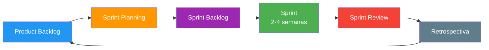

---

## 🎭 Roles y eventos de Scrum

<div class="grid grid-cols-2 gap-5 items-start">
<div>

| Rol | Responsabilidad |
|-----|-----------------|
| **Product Owner** | Dueño del producto, prioriza el backlog |
| **Scrum Master** | Facilita el proceso, quita obstáculos |
| **Team** | Desarrolladores multidisciplinares |

</div>
<div>

| Evento | Duración | Propósito |
|--------|----------|-----------|
| Sprint | 2-4 semanas | Iteración |
| Daily | 15 min | Sincronizar |
| Planning | 2-4 h | Planificar |
| Review | 1-2 h | Demostrar |
| Retro | 1-2 h | Mejorar |

</div>
</div>

---

## 📦 Artefactos y métricas de Scrum

<div class="grid grid-cols-2 gap-5 items-start">
<div>

**Artefactos:**

- **Product Backlog:** lista priorizada de funcionalidades
- **Sprint Backlog:** tareas del sprint actual
- **Incremento:** producto usable al final del sprint

</div>
<div>

**Métricas ágiles:**

- **Story points:** esfuerzo relativo (1, 2, 3, 5, 8, 13...), no horas
- **Velocity:** media de puntos por sprint (20, 25, 23 → ~23)

</div>
</div>

<TipBox type="consejo">

Con una velocity de 23 y 92 puntos pendientes, necesitas **~4 sprints** para terminar.

</TipBox>

---

## 🤝 Scrum en la práctica

<div class="grid grid-cols-2 gap-5 items-start">
<div>

<RealExample app="Proyectos C#">

En proyectos C#, Scrum es la más usada. Un sprint de 2 semanas incluye: **Planning** (qué se desarrolla), **Daily** (¿qué hice ayer? ¿qué haré hoy?), **Review** (demostrar al cliente) y **Retrospective** (mejorar el proceso).

</RealExample>

<TipBox type="nota">

En DAW practicaremos Scrum con **sprints de 2 semanas**, con roles de Product Owner, Scrum Master y equipo.

</TipBox>

</div>
<div>


</div>
</div>

---

## 🧗‍♂️ XP: eXtreme Programming

Metodología ágil que enfatiza la **calidad del código** y la satisfacción del cliente. Nació con **Kent Beck** (1996), en el proyecto de nóminas de Chrysler.

<div class="grid grid-cols-5 gap-3 items-stretch text-sm">

<ConceptCard icon="🧼" title="Simplicidad" accent="blue">

El código más simple que funcione.

</ConceptCard>

<ConceptCard icon="💬" title="Comunicación" accent="purple">

Todos hablan con todos.

</ConceptCard>

<ConceptCard icon="⏱️" title="Feedback" accent="green">

Retroalimentación rápida.

</ConceptCard>

<ConceptCard icon="🦁" title="Valentía" accent="red">

Reconocer errores y corregirlos.

</ConceptCard>

<ConceptCard icon="🙏" title="Respeto" accent="yellow">

Al equipo, con humildad.

</ConceptCard>

</div>

---

## 🛠️ Prácticas de XP

<div class="grid grid-cols-2 gap-5 items-start">
<div>

- 🧩 **Diseño sencillo:** sin anticipar necesidades futuras
- 🔧 **Mejoras continuas:** refactorización constante
- 🧪 **Pruebas primero** (TDD)
- 🔗 **Integración continua:** subir código varias veces al día

</div>
<div>

- 👥 **Pair programming:** dos personas, un ordenador
- 🙋 **El cliente en el equipo**
- 🏘️ **Propiedad compartida** del código
- 📏 **Estándares** de codificación y **40 horas** semanales

</div>
</div>

---

## 👫 Programación por parejas

<div class="grid grid-cols-2 gap-5 items-start">
<div>

<ConceptCard icon="🚗" title="Driver" accent="blue">

Escribe el código.

</ConceptCard>

<div class="mt-3">

<ConceptCard icon="🧭" title="Navigator" accent="purple">

Revisa en tiempo real, piensa en la estrategia, detecta errores y sugiere mejoras.

</ConceptCard>

</div>

</div>
<div>

<TipBox type="consejo">

Se **alternan cada 15-30 minutos**. Así hay dos cabezas en cada línea de código y menos errores.

</TipBox>


</div>
</div>

---

## 🔴🟢 TDD: primero el test

<div class="grid grid-cols-2 gap-5 items-start">
<div>

1. Escribe un **test que falle**
2. Escribe el **código mínimo** para pasarlo
3. **Refactoriza** para mejorar
4. **Repite** con otro caso

</div>
<div>

Ejemplo en C#: el test falla porque `Sumar` no existe; luego se implementa lo mínimo y pasa.

```csharp
// 1. Test que falla
Assert.AreEqual(6, Sumar(2, 4));

// 2. Lo mínimo para que pase
static int Sumar(int a, int b) => a + b;
```

</div>
</div>

---

## ✅ Cuándo usar XP

<div class="grid grid-cols-2 gap-5 items-start">
<div>

- Requisitos que **cambian** con frecuencia
- Equipos **pequeños-medios** (2-10 personas)
- Alta **incertidumbre técnica**
- Cuando la **calidad del código** es crítica

</div>
<div>

<TipBox type="truco" title="Dato">

Kent Beck escribió *Extreme Programming Explained* en 1999. El TDD y el pair programming reducen los bugs.

</TipBox>

</div>
</div>

---

## 🆚 Comparativa de metodologías

| Aspecto | Cascada | Scrum | Kanban | XP |
|---------|---------|-------|--------|-----|
| **Iteraciones** | No | Sprints | Continuo | Sí |
| **Roles** | Sí | 3 roles | No | Sí |
| **Cambios** | Difíciles | Bienvenidos | Bienvenidos | Bienvenidos |
| **Documentación** | Extensiva | Mínima | Mínima | Mínima |
| **Testing** | Al final | Continuo | Continuo | Central (TDD) |
| **Mejor para** | Requisitos fijos | Producto | Flujo continuo | Calidad |

---

## ⚔️ Scrum frente a Kanban

| Característica | Scrum | Kanban |
|----------------|-------|--------|
| **Ciclo** | Sprints fijos (2-4 sem) | Flujo continuo |
| **Roles** | PO, SM, Team | Sin roles asignados |
| **Planificación** | Al inicio del sprint | Continua |
| **Cambios** | No en un sprint activo | Cuando hay capacidad |
| **Métricas** | Velocity, burndown | Lead time, WIP |
| **Mejor para** | Objetivos claros | Mantenimiento, soporte |

---

## 🎯 ¿Qué metodología elijo?

<div class="grid grid-cols-2 gap-5 items-start">
<div>

- 💧 **Cascada:** requisitos 100% fijos (control de tráfico aéreo)
- 🏃 **Scrum:** productos web y apps, equipos de 3-9 (Netflix, funciones cada 2 semanas)
- 🗂️ **Kanban:** soporte y mantenimiento (soporte de Spotify)

</div>
<div>

- 🧗‍♂️ **XP:** calidad crítica y requisitos cambiantes (startups)
- 🎨 **Prototipos:** el cliente no sabe lo que quiere hasta verlo (Instagram nació como prototipo, *Burbn*)

<TipBox type="truco">

En proyectos reales se **combinan**: Scrum para el desarrollo + Kanban para bugs y soporte. No te obsesiones con ser «puro».

</TipBox>

</div>
</div>

---

## Resumen del punto 4

<div class="grid grid-cols-2 gap-5 items-start">
<div>

| Modelo | Cuándo usarlo |
|--------|---------------|
| **Cascada** | Requisitos fijos, proyectos pequeños |
| **En V** | Sistemas críticos, verificación estricta |
| **Prototipos** | Requisitos inciertos |
| **Espiral** | Proyectos grandes, alta incertidumbre |
| **Scrum** | Gestión de producto |
| **Kanban** | Flujo continuo |
| **XP** | Calidad de código, cambios |

</div>
<div>

<ConceptCard icon="✅" title="Buenas prácticas" accent="green">

- Elige el modelo según el proyecto, no la moda
- Cascada solo con requisitos inmutables
- Combina Scrum y Kanban si hace falta
- Prototipa cuando el cliente no sabe lo que quiere

</ConceptCard>

<div class="mt-3">

**⏭️ ¿Qué viene después?** En el **punto 5** veremos los **lenguajes de programación**, la herramienta con la que implementaremos estos modelos.

</div>

</div>
</div>

---
layout: section
---

<div class="ud-section-number">05</div>

# Lenguajes de programación

<div class="opacity-70">La herramienta con la que hablamos al ordenador</div>

---

## 5 · Punto de partida

<div class="grid grid-cols-2 gap-5 items-start">
<div>

<TipBox type="consejo" title="Punto de partida">

¿Por qué existen **tantos lenguajes**? ¿Por qué no usamos todos el mismo? Cada lenguaje está diseñado para resolver **problemas diferentes**.

</TipBox>

<TipBox type="analogia">

**Elegir lenguaje es elegir herramienta:** no se usa un martillo para atornillar. C# para apps empresariales y web, Python para datos y scripts, JavaScript para la web.

</TipBox>

</div>
<div>

<Objetivos
  :items="[
    'Definir qué es un lenguaje de programación',
    'Clasificar lenguajes por nivel, traducción y tipado',
    'Conocer los principales paradigmas',
    'Saber elegir un lenguaje según el contexto',
  ]"
/>

</div>
</div>

---

## 🌉 ¿Qué es un lenguaje de programación?

Un **lenguaje de programación** es un idioma **artificial**, formado por símbolos y normas, que permite escribir instrucciones que la máquina pueda ejecutar para producir un comportamiento deseado.

<TipBox type="analogia">

Es un **puente** entre tu mente (donde están las ideas) y el ordenador (que solo entiende 0s y 1s). Sin puente, no hay comunicación.

</TipBox>

---

## 🔤 Léxico, sintaxis y semántica

<div class="grid grid-cols-2 gap-5 items-start">
<div>

- **Alfabeto (léxico):** símbolos y palabras permitidas
- **Sintaxis:** normas para combinarlos
- **Semántica:** qué significa y qué hace cada construcción

<TipBox type="nota">

La sintaxis es la gramática. `if (x > 5` sin cerrar el paréntesis es un **error de sintaxis**.

</TipBox>

</div>
<div>

```csharp
// Léxico: 'void', 'Console', 'Saludar'
// Sintaxis: 'void Saludar(string nombre)' + llaves
// Semántica: lo que ocurre al ejecutarla

void Saludar(string nombre)
{
    Console.WriteLine($"Hola, {nombre}!");
}
```

</div>
</div>

---

## 🧱 Otros elementos importantes

<div class="grid grid-cols-2 gap-5 items-start">
<div>

| Elemento | Analogía |
|----------|----------|
| **Variables** | Cajas donde guardamos cosas |
| **Tipos de datos** | Tipo de cosa en la caja |
| **Operadores** | Acciones (+, -, *, /) |
| **Control de flujo** | Direcciones de tráfico |
| **Funciones** | Recetas reutilizables |
| **Comentarios** | Notas que no se ejecutan |

</div>
<div>


</div>
</div>

---

## 🪜 Clasificación según el nivel

Los lenguajes han evolucionado hacia una mayor **cercanía al razonamiento humano**.

<div class="grid grid-cols-2 gap-5 items-start">
<div>

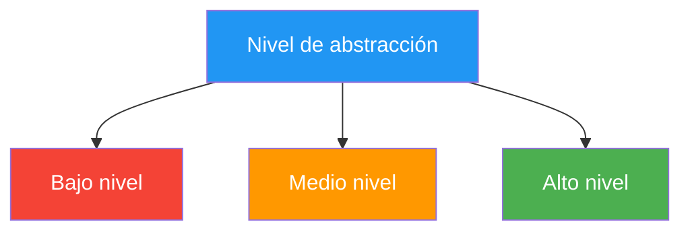

</div>
<div>


</div>
</div>

---

## ⚙️ Bajo nivel: máquina y ensamblador

Dependen totalmente de la máquina: **no son portables** y aprovechan al máximo el hardware.

<div class="grid grid-cols-2 gap-5 items-start">
<div>

**Lenguaje máquina:** unos y ceros, el único que el ordenador entiende directamente. Hoy nadie programa en él.

```
10110000 01100111  (mov al, 01100111b)
10110011 00000001  (mov bl, 00000001b)
00000010 11011000  (add al, bl)
```

</div>
<div>

**Ensamblador:** usa mnemotécnicos y necesita traducción. Códigos más cortos, pero difícil de usar.

```asm
MOV AX, 5      ; Mover 5 al registro AX
MOV BX, 3      ; Mover 3 al registro BX
ADD AX, BX     ; Sumar AX + BX
```

</div>
</div>

---

## 🔧 Medio nivel: el caso de C

Término no universalmente aceptado. **C** accede a memoria con punteros (como el bajo nivel) pero tiene estructuras de control, funciones y bibliotecas (como el alto nivel).

```c
#include <stdio.h>

int main() {
    int numero = 42;
    printf("El número es: %d\n", numero);
    return 0;
}
```

---

## 🌐 Alto nivel

Cercanos al lenguaje natural e **independientes de la arquitectura**. Necesitan traductor, incorporan librerías y *frameworks*. Es la categoría de **C#, C++, Java, Python, JavaScript y PHP**.

<div class="grid grid-cols-3 gap-4 items-start">
<div>

```csharp
// C#
int n = 42;
Console.WriteLine(n);
```

</div>
<div>

```python
# Python
n = 42
print(n)
```

</div>
<div>

```java
// Java
int n = 42;
System.out.println(n);
```

</div>
</div>

<TipBox type="truco" title="Dato">

El primer lenguaje de alto nivel fue **Fortran** (1957, John Backus, IBM). Aún se usa en cálculo científico.

</TipBox>

---

## 🔁 Según el mecanismo de traducción

El código binario ejecutable se obtiene por **compilación** o por **interpretación**.


---

## 🏗️ Lenguajes compilados

Un **compilador** traduce el código fuente a código objeto en un solo paso; un *linker* lo une con las librerías. Ejemplos: **C y C++**.

```
Código fuente (.c) → Compilador → Código objeto (.o) → Enlazador → Ejecutable (.exe)
```

<div class="grid grid-cols-2 gap-5 items-start">
<div>

✅ **Ventajas:** ejecución muy rápida y código fuente protegido

</div>
<div>

⚠️ **Desventajas:** depende de la plataforma y hay que recompilar tras cada cambio

</div>
</div>

---

## 📖 Lenguajes interpretados

Sin código objeto: un **intérprete** ejecuta el código fuente **línea a línea**. Ejemplos: **PHP y JavaScript**.

```
Código fuente (.js) → Intérprete → Ejecución directa línea a línea
```

<div class="grid grid-cols-2 gap-5 items-start">
<div>

✅ **Ventajas:** multiplataforma, desarrollo rápido y depuración fácil (error en la línea exacta)

</div>
<div>

⚠️ **Desventajas:** ejecución más lenta y código fuente visible

</div>
</div>

---

## 🧬 Lenguajes mixtos o virtuales

Compilan a un **bytecode** que ejecuta una **máquina virtual**: se compila una vez y se ejecuta en distintos sistemas. Ejemplos: **Java, C# y Python**.

```
Código fuente (.java) → Compilador → Bytecode (.class) → JVM → Ejecución
```

<div class="grid grid-cols-2 gap-5 items-start">
<div>

<RealExample app="Android">

Al descargar una app no descargas Java, sino **bytecode** (.dex) que ejecuta la máquina virtual ART.

</RealExample>

</div>
<div>

<TipBox type="consejo">

En C# el código intermedio (IL) hace que el mismo `.dll` corra en Windows, Linux o Mac **sin recompilar**, si hay máquina virtual.

</TipBox>

</div>
</div>

---

## 🔀 Lenguajes transpilados

Un **transpilador** traduce de un lenguaje a otro de **similar nivel de abstracción** (alto → alto).

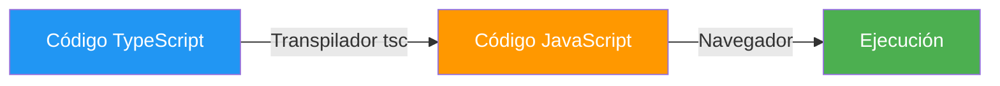

<TipBox type="analogia">

Un compilador traduce un libro de español a japonés (alto → bajo). Un transpilador, de español a portugués (alto → alto).

</TipBox>

---

## 📘 Transpilación: TypeScript → JavaScript

<div class="grid grid-cols-2 gap-5 items-start">
<div>

```typescript
// TypeScript (tipado, moderno)
function saludar(nombre: string): string {
    return `Hola, ${nombre}`;
}
```

</div>
<div>

```javascript
// Resultado en JavaScript (sin tipos)
function saludar(nombre) {
    return `Hola, ${nombre}`;
}
```

</div>
</div>

| Desde | Hasta | Herramienta |
|-------|-------|-------------|
| TypeScript | JavaScript | tsc, Babel |
| Sass/Less | CSS | sass, less |
| Kotlin | JavaScript | kotlin-js |

<TipBox type="nota">

TypeScript es más seguro y mantenible, pero los navegadores solo entienden JavaScript: el transpilador salva esa brecha.

</TipBox>

---

## 🏷️ Sistema de tipos

Un **tipo de dato** define los valores posibles, las operaciones válidas y la **memoria** que se reserva. El sistema de tipos se clasifica en tres dimensiones:

<div class="grid grid-cols-3 gap-4 items-stretch">

<ConceptCard icon="💪" title="Rigidez" accent="blue">

**Fuerte o débil:** ¿se permiten conversiones automáticas?

</ConceptCard>

<ConceptCard icon="⏰" title="Verificación" accent="purple">

**Estático o dinámico:** ¿cuándo se comprueban los tipos?

</ConceptCard>

<ConceptCard icon="✍️" title="Declaración" accent="green">

**Explícito o implícito:** ¿se escribe el tipo o se infiere?

</ConceptCard>

</div>

---

## 💪 Tipado fuerte frente a débil

<div class="grid grid-cols-2 gap-5 items-start">
<div>

**Fuerte** (C#, Java, Python): no hay conversiones implícitas entre tipos no relacionados; previene errores.

```csharp
// C#
int resultado = "hola";  // Error de compilación
```

```python
# Python
resultado = 5 + "3"  # TypeError
```

</div>
<div>

**Débil** (JavaScript, PHP): convierte tipos automáticamente; puede ocultar errores.

```javascript
// JavaScript
resultado = "5" + 3  // "53"
resultado = "5" - 3  // 2
```

</div>
</div>

---

## ⏰ Tipado estático frente a dinámico

<div class="grid grid-cols-2 gap-5 items-start">
<div>

**Estático** (C#, C++, Java, TypeScript): se verifica en **compilación**; si hay error, no compila.

```csharp
int numero = 42;
// numero = "texto"; // Error de compilación
```

</div>
<div>

**Dinámico** (Python, JavaScript, PHP): se verifica en **ejecución**; una variable puede cambiar de tipo.

```python
variable = 42         # int
variable = "texto"    # ahora es str
variable = [1, 2, 3]  # ahora es list
```

</div>
</div>

---

## ✍️ Tipado explícito e implícito

<div class="grid grid-cols-2 gap-5 items-start">
<div>

**Explícito:** declaras el tipo. Más claro de leer.

- C#: `int numero = 10;`
- Java: `int numero = 10;`

**Implícito (inferencia):** el compilador deduce el tipo.

- C#: `var numero = 10;`
- Kotlin: `val numero = 10`
- TypeScript: `let numero = 10`

</div>
<div>

<TipBox type="consejo" title="¿var o tipo explícito?">

Usa `var` cuando el tipo es evidente: `var nombre = "Ana"`. Usa el tipo explícito cuando no: `List<Persona> personas = ObtenerPersonas()`.

</TipBox>

<TipBox type="nota">

El **ensamblador** no tiene sistema de tipos: son simples secuencias de bits.

</TipBox>

</div>
</div>

---

## 🗃️ Resumen de sistemas de tipado

| Sistema | Descripción | Lenguajes |
|---------|-------------|-----------|
| **Estático y fuerte** | Compilación; sin conversiones implícitas | C++, Java, C#, Swift, Kotlin |
| **Dinámico y fuerte** | Ejecución; sin conversiones implícitas | Python, Ruby, Haskell |
| **Estático y débil** | Compilación; con conversiones implícitas | C, VBScript |
| **Dinámico y débil** | Ejecución; con conversiones implícitas | JavaScript, PHP, Perl |

<TipBox type="nota">

No hay un «mejor» sistema. El tipado estático detecta errores antes pero pide más código; el dinámico escribe más rápido pero puede ocultar errores hasta producción.

</TipBox>

---

## 🧩 Paradigmas de programación

Un **paradigma** es un modelo para diseñar programas. Lenguajes como **Java, Kotlin y C#** son **multiparadigma**.

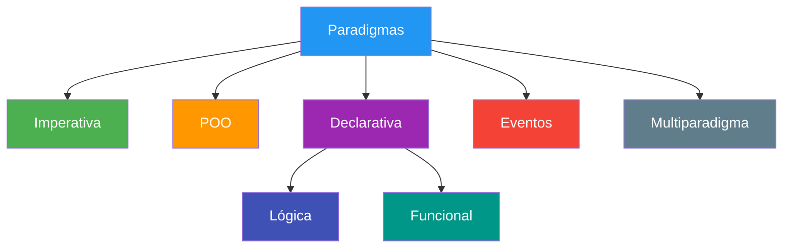

---

## 📋 Imperativa y procedimental

**Imperativa/estructurada:** órdenes ejecutadas en orden; usa sentencias **secuenciales, selectivas y repetitivas**. Ejemplos: C, Pascal. La **procedimental** la organiza en funciones.

```c
int main() {
    int i, suma = 0;
    for (i = 1; i <= 10; i++) {  // Repetitiva
        if (i % 2 == 0) {         // Selectiva
            suma += i;             // Secuencial
        }
    }
    return 0;
}
```

---

## 🧸 Programación orientada a objetos

Programas como **objetos** que interactúan: instancias de una **clase** con datos y métodos. Sus pilares: **polimorfismo, herencia y encapsulación**.

```csharp
class Coche
{
    public string Marca { get; set; }
    public string Modelo { get; set; }

    public Coche(string marca, string modelo)
    {
        Marca = marca;
        Modelo = modelo;
    }

    public void Arrancar() => Console.WriteLine($"{Marca} {Modelo} arrancado");
}

var miCoche = new Coche("Toyota", "Corolla");
miCoche.Arrancar();
```

---

## 🧠 Programación declarativa

Describe el **resultado deseado**, no el proceso paso a paso.

<div class="grid grid-cols-2 gap-5 items-start">
<div>

<ConceptCard icon="🔎" title="Lógica" accent="purple">

Reglas de lógica formal; muy usada en IA. Ejemplo: **Prolog**. Declaras `padre(juan, maria).` y preguntas `?- padre(juan, X).`

</ConceptCard>

</div>
<div>

<ConceptCard icon="🧮" title="Funcional" accent="blue">

**Funciones matemáticas** sin estado externo. C# (LINQ) y Java (Streams) la incorporan. Ejemplos: Haskell, Lisp, Scala.

</ConceptCard>

</div>
</div>

---

## 🧮 Funcional en la práctica

<div class="grid grid-cols-2 gap-5 items-start">
<div>

```csharp
// C# (LINQ + lambda)
int[] numeros = [1, 2, 3, 4, 5, 6, 7, 8, 9, 10];

var cuadrados = numeros.Select(x => x * x);
var pares = numeros.Where(x => x % 2 == 0);
int suma = numeros.Aggregate((a, b) => a + b);
```

</div>
<div>

```python
# Python
numeros = [1, 2, 3, 4, 5, 6, 7, 8, 9, 10]
cuadrados = list(map(lambda x: x**2, numeros))
pares = list(filter(lambda x: x % 2 == 0, numeros))
```

</div>
</div>

---

## 🖱️ Eventos y reactiva

<div class="grid grid-cols-2 gap-5 items-start">
<div>

**Eventos:** el flujo lo dirigen clics, movimientos del ratón o cambios del sistema. Muy común en interfaces gráficas y servidores.

```csharp
miBoton.Click += (sender, e) =>
{
    MessageBox.Show("¡Botón pulsado!");
};
```

</div>
<div>

**Reactiva:** subtipo de eventos centrado en **flujos de datos asíncronos** y propagación de cambios. Ideal para datos en tiempo real (RxJava, Rx.NET).

<TipBox type="nota">

**Multiparadigma:** C++, JavaScript, Python, Java, Kotlin y C# combinan varios y eligen el mejor para cada parte.

</TipBox>

</div>
</div>

---

## 📊 Paradigmas: resumen

| Paradigma | Idea central | Lenguajes | Uso |
|-----------|--------------|-----------|-----|
| **Imperativo** | Secuencia de pasos | C, Pascal | Scripts, sistemas |
| **POO** | Objetos con datos y métodos | Java, C#, C++ | Apps empresariales |
| **Funcional** | Funciones puras, sin estado | Haskell, F#, Lisp | Procesamiento de datos |
| **Declarativo** | Describes qué, no cómo | SQL, HTML | BBDD, web |
| **Multiparadigma** | Combina varios | C#, Python, JavaScript | Proyectos modernos |

---

## 📅 Según generaciones

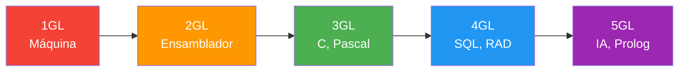

<TipBox type="truco" title="Dato">

En DAW veremos sobre todo **3GL** (C, Java, Python) y **4GL** (SQL). Python es 3GL, pero se usa en IA por sus librerías (TensorFlow, PyTorch).

</TipBox>

---

## ⚖️ Criterios para elegir lenguaje

<div class="grid grid-cols-2 gap-5 items-start">
<div>

| Criterio | Pregunta clave |
|----------|----------------|
| **Campo de aplicación** | ¿Web, móvil, escritorio, ciencia? |
| **Experiencia** | ¿El equipo lo conoce? |
| **Herramientas** | ¿IDEs, frameworks, librerías? |
| **Documentación** | ¿Hay buena documentación? |
| **Comunidad** | ¿Quién puede ayudar? |

</div>
<div>

| Criterio | Pregunta clave |
|----------|----------------|
| **Rendimiento** | ¿Necesita velocidad? |
| **Reusabilidad** | ¿Hay código reutilizable? |
| **Portabilidad** | ¿Varias plataformas? |
| **Coste** | ¿Licencias y formación? |
| **Cliente** | ¿Impone algo? |

</div>
</div>

<TipBox type="nota">

No existe el «mejor» lenguaje, sino el **adecuado**: Python para ML, C++ para videojuegos AAA, JavaScript/Node.js para una startup web.

</TipBox>

---

## 🏆 Lenguajes más utilizados

El índice [TIOBE](https://www.tiobe.com/tiobe-index/) mide la demanda de lenguajes. Los diez primeros:

<div class="grid grid-cols-2 gap-5 items-start">
<div>

1. **Python:** IA, ciencia de datos, web
2. **C:** sistemas embebidos
3. **C++:** juegos, rendimiento crítico
4. **Java:** empresa, Android, web
5. **C#:** Windows, Unity, web

</div>
<div>

6. **JavaScript:** web frontend y backend
7. **SQL:** bases de datos
8. **R:** estadística
9. **Rust:** sistemas seguros
10. **Go:** cloud, microservicios

</div>
</div>

---

## 💼 Lenguajes por área profesional

| Área | Lenguajes típicos |
|------|-------------------|
| **Web frontend** | JavaScript, TypeScript |
| **Web backend** | Python, Java, Node.js, PHP, Ruby, C# |
| **Móvil** | Swift (iOS), Kotlin/Java (Android), Dart (Flutter) |
| **Ciencia de datos** | Python, R, Julia |
| **Sistemas embebidos** | C, C++, Rust |
| **Videojuegos** | C++, C#, Lua |
| **DevOps/Scripting** | Python, Bash, Go |
| **Inteligencia artificial** | Python, Lisp, Prolog |

---

## 🎯 ¿Y C#? Una apuesta segura

<div class="grid grid-cols-2 gap-5 items-start">
<div>

C# es uno de los lenguajes más **versátiles**:

- 🌐 Web con **ASP.NET**
- 🖥️ Escritorio con **WPF y MAUI**
- 🎮 Juegos con **Unity**
- 📱 Móviles con **.NET MAUI**
- ☁️ Nube con **Azure**

</div>
<div>

<TipBox type="consejo">

Mira el **ecosistema**, no solo el lenguaje: Python tiene PyPI (500K+ paquetes) y C# tiene NuGet (400K+).

</TipBox>

<RealExample app="Spotify">

Java en el backend, Python para análisis de datos y JavaScript/TypeScript en la web: cada lenguaje resuelve un problema distinto.

</RealExample>

</div>
</div>

---

## Resumen del punto 5

<div class="grid grid-cols-2 gap-5 items-start">
<div>

| Concepto | Descripción |
|----------|-------------|
| **Bajo nivel** | Máquina, ensamblador |
| **Alto nivel** | Python, Java, C# |
| **Compilado** | C, C++ (rápido) |
| **Interpretado** | JavaScript, PHP |
| **Mixto** | Java, C# (bytecode) |
| **Tipado fuerte** | C#, Java, Python |
| **Tipado débil** | JavaScript, PHP |
| **POO** | Java, C#, Python |

</div>
<div>

<ConceptCard icon="✅" title="Buenas prácticas" accent="green">

- Elige el lenguaje según el contexto
- Mira el ecosistema, no solo el lenguaje
- Considera el mercado laboral
- Domina uno (C#) y conoce 2-3 más

</ConceptCard>

<div class="mt-3">

**⏭️ ¿Qué viene después?** En el **punto 6** veremos la **traducción de lenguajes**: cómo el código de alto nivel se convierte en instrucciones que el procesador ejecuta.

</div>

</div>
</div>

---
layout: section
---

<div class="ud-section-number">06</div>

# Proceso de traducción y máquinas virtuales

<div class="opacity-70">Cómo tu código llega a ejecutarse</div>

---

## 6 · Punto de partida

<div class="grid grid-cols-2 gap-5 items-start">
<div>

<TipBox type="consejo" title="Punto de partida">

¿Cómo se convierte tu código en algo que el procesador entiende? ¿Y por qué la misma aplicación funciona en **Windows, Linux y Mac**? La respuesta: la traducción y las máquinas virtuales.

</TipBox>

<TipBox type="analogia">

**Compilar** es traducir TODO un libro japonés al español antes de leerlo. **Interpretar** es leerlo con un traductor que va frase por frase.

</TipBox>

</div>
<div>

<Objetivos
  :items="[
    'Diferenciar compilación, interpretación y mixtos',
    'Conocer las 7 fases de un traductor',
    'Distinguir código fuente, objeto y ejecutable',
    'Entender qué es una máquina virtual',
    'Conocer entornos de ejecución y frameworks',
  ]"
/>

</div>
</div>

---

## 🔄 Traducción, compilación e interpretación

La **traducción** transforma código de un lenguaje a otro. Lo hace un **traductor**: un compilador o un intérprete.

<div class="grid grid-cols-2 gap-5 items-start">
<div>

<ConceptCard icon="🏗️" title="Compilación" accent="blue">

Traduce **todo** el código fuente a código objeto o ejecutable en un solo paso. Ej.: `gcc` en C.

</ConceptCard>

</div>
<div>

<ConceptCard icon="📖" title="Interpretación" accent="purple">

Traduce y ejecuta **línea a línea**, sin archivo intermedio. Ej.: Node.js con JavaScript.

</ConceptCard>

</div>
</div>

---

## 🆚 Compilación frente a interpretación

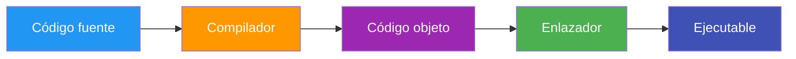

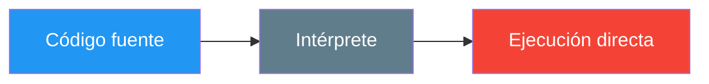

---

## 🖼️ Vista de conjunto


---

## 📊 Tabla comparativa

| Característica | Compilación | Interpretación | Mixto |
|----------------|-------------|----------------|-------|
| **Traducción** | Todo de una vez | Línea a línea | Intermedio + JIT |
| **Velocidad** | Rápida | Lenta | Media-buena |
| **Portabilidad** | Baja (por SO) | Alta | Alta |
| **Ejemplos** | C, C++, Go | Python, Ruby | Java, C# |
| **Ejecutable** | Sí (.exe) | No | No (.dll + MV) |

---

## 🧬 Traducción mixta

Compila a **bytecode**, que luego ejecuta una máquina virtual. Ejemplos: Java y C#.

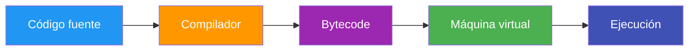

<div class="grid grid-cols-2 gap-5 items-start">
<div>

<RealExample app="Java">

`MiApp.java` → `javac` → `MiApp.class` (bytecode) → `java` (JVM) → ejecución en Windows, Linux o Mac.

</RealExample>

</div>
<div>

<TipBox type="nota">

**Python** funciona así: `python programa.py` compila a bytecode (`.pyc`) y lo interpreta. Por eso la segunda ejecución es más rápida.

</TipBox>

</div>
</div>

---

## 🖼️ Lenguaje mixto


---

## 🔀 Transpilación

Traduce de un lenguaje de alto nivel a otro de **similar nivel**.

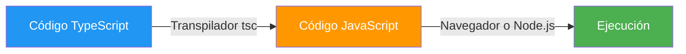

<div class="grid grid-cols-2 gap-5 items-start">
<div>

<RealExample app="TypeScript">

Tipos estáticos y más seguridad, pero los navegadores solo entienden JavaScript: `tsc` o Babel convierten `.ts` en `.js`.

</RealExample>

</div>
<div>

<RealExample app="React">

Se escribe **JSX** (JavaScript + HTML) porque es más legible; Babel lo convierte en llamadas a `React.createElement()`.

</RealExample>

</div>
</div>

---

## 🧩 Las fases de un traductor

Un traductor no traduce palabra por palabra: sigue **fases bien definidas**.

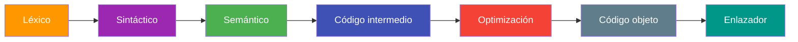

<TipBox type="nota">

Entender las fases ayuda a leer los errores: *unexpected token* es **léxico**, *syntax error* es **sintáctico**, *incompatible types* es **semántico**.

</TipBox>

---

## 🖼️ Fases de un compilador


---

## 1️⃣ Análisis léxico (scanner)

Lee el código **carácter a carácter** y lo agrupa en **tokens**: palabras clave, identificadores, operadores y literales. Elimina comentarios y espacios.

<div class="grid grid-cols-2 gap-5 items-start">
<div>

`int suma = a + 5;` se descompone en:

- `int` → KEYWORD
- `suma` → ID
- `=` → ASSIGN
- `a` → ID
- `+` → PLUS
- `5` → NUMBER
- `;` → SEMICOLON

</div>
<div>

<TipBox type="analogia">

Es como un niño aprendiendo a leer: primero letras, luego sílabas y por fin palabras. **Caracteres → palabras → tokens.**

</TipBox>

</div>
</div>

---

## 2️⃣ Análisis sintáctico (parser)

Comprueba que los tokens formen una estructura gramaticalmente correcta y genera el **árbol sintáctico (AST)**.

<div class="grid grid-cols-2 gap-5 items-start">
<div>

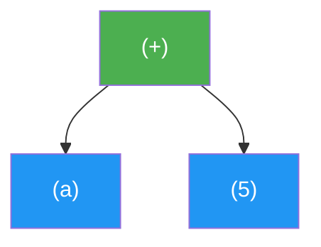

Árbol de `a + 5`. El compilador trabaja con el AST, no con el código original.

</div>
<div>

**Errores típicos de sintaxis:**

- Paréntesis sin cerrar: `if (x > 5 { ... }`
- Punto y coma faltante
- Palabra clave mal escrita: `whille (true)`

<TipBox type="nota">

*Syntax error at line 10* significa que los tokens no se pueden organizar en una estructura válida.

</TipBox>

</div>
</div>

---

## 3️⃣ Análisis semántico

Verifica que el programa tenga **sentido**: tipos compatibles, variables declaradas y argumentos correctos.

```csharp
int resultado = "texto" + 5;  // Cannot implicitly convert type 'string' to 'int'

Console.WriteLine(x);          // The name 'x' does not exist in the current context

static int Sumar(int a, int b) => a + b;
Sumar(1, 2, 3);                // Too many arguments, expected 2
```

<TipBox type="consejo">

Sintaxis correcta no es semántica correcta: «El gato come la televisión» es gramatical, pero no tiene sentido.

</TipBox>

---

## 4️⃣ Código intermedio

Muchos compiladores generan un código parecido al ensamblador pero **independiente de la arquitectura**, que simplifica las optimizaciones.

<div class="grid grid-cols-2 gap-5 items-start">
<div>

`x = a + 5 * y` en código de tres direcciones:

```
t1 = 5 * y
t2 = a + t1
x = t2
```

</div>
<div>

<TipBox type="nota">

Java usa el **bytecode** como código intermedio: un ensamblador universal que entienden todas las JVM.

</TipBox>

</div>
</div>

---

## 5️⃣ Optimización

Fase opcional pero crucial: reduce el tiempo de ejecución, el tamaño o la memoria.

<div class="grid grid-cols-2 gap-5 items-start">
<div>

| Técnica | Antes → después |
|---------|-----------------|
| **Const folding** | `x = 3 + 5` → `x = 8` |
| **Dead code elimination** | Código inalcanzable → eliminado |
| **Loop unrolling** | Bucle → instrucciones repetidas |
| **Inlining** | Llamada → código inline |

</div>
<div>

<TipBox type="truco" title="Dato">

`gcc` con `-O3` puede hacer el código **10-100 veces más rápido**, pero el resultado es casi ilegible para humanos.

</TipBox>

</div>
</div>

---

## 6️⃣ Generación de código objeto

El código intermedio optimizado se convierte en **código máquina** de la arquitectura concreta (x86, ARM): instrucciones que la CPU ejecuta directamente.

<TipBox type="advertencia">

Aún **no es un programa completo**: las referencias a funciones o datos de otras partes o de librerías externas están como etiquetas simbólicas.

</TipBox>

---

## 7️⃣ Enlazador y cargador

<div class="grid grid-cols-2 gap-5 items-start">
<div>

<ConceptCard icon="🔗" title="Enlazador (linker)" accent="blue">

Combina el código objeto con las **librerías** y resuelve las referencias, creando un único **ejecutable**.

</ConceptCard>

<TipBox type="analogia">

Es el editor de un libro que une los capítulos de distintos autores con el índice y las referencias cruzadas.

</TipBox>

</div>
<div>

<ConceptCard icon="🚚" title="Cargador (loader)" accent="green">

Carga el ejecutable en la **RAM** y prepara su ejecución cuando el usuario lo inicia.

</ConceptCard>

<TipBox type="consejo">

Tu `Console.WriteLine("Hola")` no incluye `WriteLine`: el linker lo conecta con `System.Console.dll`.

</TipBox>

</div>
</div>

---

## 📄 Fuente, objeto y ejecutable

<div class="grid grid-cols-3 gap-4 items-stretch">

<ConceptCard icon="📝" title="Código fuente" accent="blue">

Archivo de texto legible, no ejecutable. Puede ser **abierto** o **cerrado**. `.c` `.java` `.py` `.js`

</ConceptCard>

<ConceptCard icon="📦" title="Código objeto" accent="purple">

Binario **no ejecutable** resultado de compilar. En Java es el **bytecode**. `.o` `.obj` `.class`

</ConceptCard>

<ConceptCard icon="🚀" title="Ejecutable" accent="green">

Código máquina que el SO carga en RAM. Los interpretados no generan objeto. `.exe` `.app` `.bin`

</ConceptCard>

</div>

---

## 🧭 El camino del código

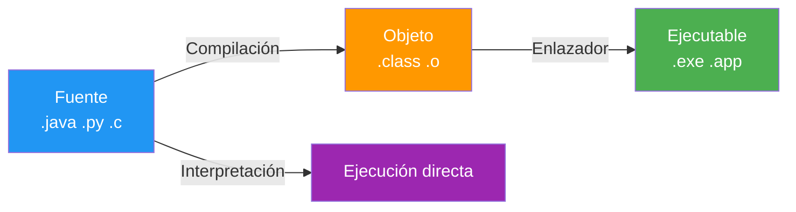

<TipBox type="truco" title="Dato">

En Java: `javac` genera el bytecode (`.class`) y `java MiClase` hace que la JVM lo cargue y lo interprete o compile a código nativo (JIT).

</TipBox>

---

## 🖥️ Máquinas virtuales

Una **máquina virtual (MV)** separa el funcionamiento del ordenador de su hardware: es una capa de software entre el bytecode y los dispositivos físicos. Garantiza la **portabilidad**.

<div class="grid grid-cols-2 gap-5 items-start">
<div>

<TipBox type="analogia">

Es un **traductor universal**: tú hablas una vez y él traduce a cualquier idioma (Windows, Linux o Mac).

</TipBox>

</div>
<div>

<TipBox type="consejo">

Sin MV compilarías por separado para cada SO. Con ella, compilas **una vez** a código intermedio.

</TipBox>

</div>
</div>

---

## ⚙️ Funciones de una máquina virtual

<div class="grid grid-cols-2 gap-4 items-stretch">

<ConceptCard icon="🔁" title="Portabilidad" accent="blue">

Ejecuta el mismo código en diferentes sistemas operativos.

</ConceptCard>

<ConceptCard icon="🧹" title="Gestión de memoria" accent="green">

Reserva y libera memoria automáticamente (*garbage collector*).

</ConceptCard>

<ConceptCard icon="🛡️" title="Seguridad" accent="red">

Aísla las aplicaciones entre sí.

</ConceptCard>

<ConceptCard icon="✔️" title="Verificación" accent="purple">

Comprueba el bytecode antes de ejecutarlo.

</ConceptCard>

</div>

---

## 🧱 La máquina virtual en capas


<div class="grid grid-cols-2 gap-5 items-start">
<div>

- **JVM:** Java, Kotlin, Scala
- **CLR:** C#, VB.NET

</div>
<div>

- **Python VM:** Python
- **BEAM:** Erlang, Elixir

</div>
</div>

---

## 🖼️ Máquina virtual de Java

<div class="grid grid-cols-2 gap-5 items-start">
<div>


</div>
<div>


</div>
</div>

<TipBox type="nota">

El proceso completo de C# lo veremos en el **punto 9**, desde `Program.cs` hasta la ejecución.

</TipBox>

---

## 🏃 Entornos de ejecución

Un **entorno de ejecución** es el servicio de máquina virtual que sirve de base para ejecutar programas. Lo forman la **máquina virtual** y las **API** (bibliotecas estándar), distribuidas juntas.

<div class="grid grid-cols-2 gap-5 items-start">
<div>

| Entorno | Lenguaje |
|---------|----------|
| **JRE** | Java |
| **.NET Runtime** | C# |
| **Node.js** | JavaScript |
| **Python Runtime** | Python |

</div>
<div>

<TipBox type="nota">

Al instalar Python instalas el **intérprete + la biblioteca estándar + el runtime**. Sin ello no podrías ejecutar programas `.py`.

</TipBox>

</div>
</div>

---

## 🧰 Frameworks

Un **framework** es una estructura de ayuda para desarrollar proyectos **sin partir de cero**: programas de soporte, bibliotecas y módulos.

<div class="grid grid-cols-2 gap-5 items-start">
<div>

<TipBox type="analogia">

Es un **kit de muebles de IKEA**: no diseñas las piezas, sigues las instrucciones y lo montas.

</TipBox>

</div>
<div>

✅ **Ventajas:**

- Desarrollo rápido y diseño uniforme
- Reutilización de código
- Portabilidad vía bytecode

⚠️ **Inconvenientes:** curva de aprendizaje, dependencia del framework y posible *overhead*.

</div>
</div>

---

## 🧪 Frameworks por lenguaje

| Lenguaje | Frameworks populares |
|----------|----------------------|
| **Java** | Spring, Jakarta EE, Vaadin |
| **Python** | Django, Flask, FastAPI |
| **JavaScript** | React, Vue, Angular, Node.js |
| **PHP** | Laravel, Symfony, WordPress |
| **C#** | .NET, ASP.NET, Entity Framework |

---

## 🎯 ¿Compilado, interpretado o mixto?

<div class="grid grid-cols-2 gap-5 items-start">
<div>

- **Compilados (C, C++):** máximo rendimiento (Unreal Engine)
- **Interpretados (Python, JS):** prototipos, scripts y automatización
- **Mixtos (C#, Java):** equilibrio portabilidad-rendimiento (ASP.NET Core en cualquier SO)

</div>
<div>

- **Transpilados (TypeScript):** origen más seguro, destino ejecutable por la plataforma

<TipBox type="truco">

En C# compila en **Debug** durante el desarrollo y en **Release** para producción: Release aplica optimizaciones agresivas.

</TipBox>

</div>
</div>

---

## Resumen del punto 6

<div class="grid grid-cols-2 gap-5 items-start">
<div>

| Concepto | Descripción |
|----------|-------------|
| **Compilación** | Traduce todo → ejecutable |
| **Interpretación** | Traduce y ejecuta línea a línea |
| **Mixto** | Bytecode + máquina virtual |
| **Léxico / sintáctico / semántico** | Tokens → árbol → sentido |
| **Fuente / objeto / ejecutable** | `.java` / `.class` / `.exe` |
| **Máquina virtual** | JVM, CLR: hace portable el código |
| **Framework** | Kit reutilizable |

</div>
<div>

<ConceptCard icon="✅" title="Buenas prácticas" accent="green">

- Compila en Debug para desarrollar y en Release para producir
- Usa el tipo de traducción adecuado al proyecto
- Lee el error: léxico, sintáctico o semántico
- Usa TypeScript en equipos grandes

</ConceptCard>

<div class="mt-3">

**⏭️ ¿Qué viene después?** En el **punto 7** veremos las **herramientas de apoyo** al desarrollo: editores, IDEs y utilidades del día a día.

</div>

</div>
</div>

---
layout: section
---

<div class="ud-section-number">07</div>

# Herramientas de apoyo al desarrollo

<div class="opacity-70">IDE, CASE, RAD, Git y Docker</div>

---

## 7 · Punto de partida

<div class="grid grid-cols-2 gap-5 items-start">
<div>

<TipBox type="consejo" title="Punto de partida">

¿Cómo se crea una aplicación completa sin escribir todo desde cero? ¿Y cómo trabajan **10 personas** sobre el mismo proyecto? Con las herramientas de apoyo.

</TipBox>

<TipBox type="analogia">

**Son los instrumentos de un mecánico:** puedes cambiar una rueda con una llave básica, pero con las herramientas adecuadas es más rápido, seguro y profesional.

</TipBox>

</div>
<div>

<Objetivos
  :items="[
    'Conocer las herramientas principales del desarrollo',
    'Entender qué son las herramientas CASE',
    'Diferenciar editores simples e IDEs',
    'Saber elegir la herramienta según el contexto',
  ]"
/>

</div>
</div>

---

## 🧰 Herramientas de desarrollo

Se usan para **automatizar tareas** y ganar fiabilidad y tiempo, de modo que el equipo se centre en los requisitos y el análisis, que son las causas principales de los fallos.

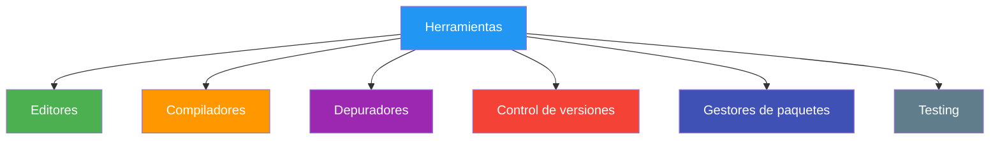

---

## 📋 Categorías y ejemplos

| Categoría | Herramientas populares | Función |
|-----------|------------------------|---------|
| **Editores** | Visual Studio Code, Visual Studio, Vim | Escribir código |
| **Compiladores** | dotnet (C#), javac (Java), gcc (C/C++) | Traducir código |
| **Intérpretes** | dotnet run, node, python | Ejecutar directamente |
| **Depuradores** | Visual Studio Debugger, Chrome DevTools | Encontrar errores |
| **Control de versiones** | Git, SVN, Mercurial | Gestionar cambios |
| **Gestores de paquetes** | NuGet, npm, maven, gradle | Instalar librerías |
| **Testing** | NUnit, pytest, Jest | Verificar código |

<TipBox type="nota">

En DAW dominar **JetBrains Rider** y **Git** es casi tan importante como saber programar.

</TipBox>

---

## 🏗️ Herramientas CASE

**CASE** (*Computer Aided Software Engineering*) reúne aplicaciones que reducen **costes y tiempo** y mejoran la productividad.

<div class="grid grid-cols-2 gap-5 items-start">
<div>

<TipBox type="analogia">

Es como el **CAD** (diseño asistido por computadora), pero para software.

</TipBox>

</div>
<div>

**Funcionalidad:**

- Automatizar tareas repetitivas
- Generar código a partir de modelos
- Crear diagramas (UML, ER, flujo)
- Validar requisitos y documentar

</div>
</div>

---

## 🧱 Clasificación de las herramientas CASE

<div class="grid grid-cols-2 gap-5 items-start">
<div>

```mermaid
graph TD
    A[CASE] --> B[U-CASE]
    A --> C[M-CASE]
    A --> D[L-CASE]
    style A fill:#2196F3,color:#fff
    style B fill:#4CAF50,color:#fff
    style C fill:#FF9800,color:#fff
    style D fill:#9C27B0,color:#fff
```

</div>
<div>

| Tipo | Fases | Ejemplos |
|------|-------|----------|
| **U-CASE** | Planificación, análisis | StarUML, Enterprise Architect |
| **M-CASE** | Análisis, diseño | Rational Rose, Visual Paradigm |
| **L-CASE** | Codificación, pruebas | Visual Studio, IDEs |

</div>
</div>

---

## 🆓 CASE gratuitas y modernas

<div class="grid grid-cols-2 gap-5 items-start">
<div>

**Gratuitas o libres:**

- **ArgoUML:** UML open source
- **Dia:** diagramas diversos
- **StarUML:** UML con versión gratuita
- **PlantUML:** UML mediante texto

</div>
<div>

**Modernas:** PlantUML, **Draw.io**, **Mermaid** (diagramas en Markdown).

<TipBox type="nota">

Las CASE se usan sobre todo en **análisis y diseño**, para documentar el sistema con UML antes de programar.

</TipBox>

</div>
</div>

---

## ⚡ RAD: desarrollo rápido

El **Desarrollo Rápido de Aplicaciones** une desarrollo iterativo, prototipos y utilidades CASE. Lo creó **James Martin en 1991** por la lentitud de los métodos tradicionales.

```mermaid
graph LR
    A[Requisitos] --> B[Prototipo]
    B --> C[Pruebas usuario]
    C --> D[Construcción]
    D --> E[Despliegue]
    style A fill:#2196F3,color:#fff
    style B fill:#FF9800,color:#fff
    style C fill:#9C27B0,color:#fff
    style D fill:#4CAF50,color:#fff
    style E fill:#3F51B5,color:#fff
```

---

## ⚖️ RAD: pros, contras y herramientas

<div class="grid grid-cols-2 gap-5 items-start">
<div>

✅ **Ventajas:** menos *time-to-market*, feedback temprano y más participación del cliente.

⚠️ **Desventajas:** puede sacrificar calidad, necesita usuarios disponibles y no sirve para proyectos muy grandes.

</div>
<div>

**Herramientas RAD:**

- **Power Apps:** low-code de Microsoft
- **OutSystems:** plataforma empresarial
- **Bubble:** web sin código
- **Retool:** interfaces de gestión

<TipBox type="nota">

**Low-code** y **no-code** son los herederos de RAD, con limitaciones.

</TipBox>

</div>
</div>

---

## 🖥️ ¿Qué es un IDE?

Un **Entorno de Desarrollo Integrado** agrupa editor, compilador y depurador en una **única interfaz** para aumentar la productividad.

```mermaid
graph TB
    A[IDE] --> B[Editor]
    A --> C[Compilador]
    A --> D[Depurador]
    A --> E[Proyectos]
    A --> F[Refactorización]
    A --> G[Git]
    style A fill:#2196F3,color:#fff
    style B fill:#4CAF50,color:#fff
    style C fill:#FF9800,color:#fff
    style D fill:#9C27B0,color:#fff
    style E fill:#f44336,color:#fff
    style F fill:#3F51B5,color:#fff
    style G fill:#607D8B,color:#fff
```

---

## 🧩 Componentes de un IDE

| Componente | Descripción | Ejemplo |
|------------|-------------|---------|
| **Editor avanzado** | Resaltado, sangrado, navegación | IntelliSense, snippets |
| **Compilador integrado** | Traducir sin salir del IDE | Build, Compile |
| **Depurador visual** | Puntos de ruptura, inspección | Breakpoints, watch |
| **Refactorización** | Renombrar, extraer métodos | Rename, Extract |
| **Gestor de proyectos** | Organizar archivos | Solution Explorer |
| **Control de versiones** | Git integrado | Panel Git |

---

## 🏅 IDEs populares por lenguaje

<div class="grid grid-cols-2 gap-5 items-start">
<div>

| Lenguaje | IDE principal | Alternativas |
|----------|---------------|--------------|
| **C#** | JetBrains Rider | VS Code, Visual Studio |
| **Java** | IntelliJ IDEA | Eclipse, NetBeans |
| **Python** | PyCharm | VS Code, Spyder |
| **C/C++** | CLion | Visual Studio, VS Code |
| **JavaScript** | WebStorm | VS Code, Atom |

</div>
<div>

<TipBox type="truco" title="Dato">

**Eclipse** (1999, IBM, para Java) fue el primer IDE. Antes se editaba en terminales y se compilaba a mano.

</TipBox>

</div>
</div>

---

## 💙 Visual Studio Code

<div class="grid grid-cols-2 gap-5 items-start">
<div>

<TipBox type="consejo" title="Por qué dominarlo">

Es **ligero y rápido**, **multiplataforma**, **extensible**, **gratis y open source** y se usa en la industria.

</TipBox>

</div>
<div>

| Extensión | Utilidad |
|-----------|----------|
| C# Dev Kit | Soporte C#/.NET |
| Prettier | Formateo |
| ESLint | Linting JavaScript |
| GitLens | Mejora Git |
| Live Server | Servidor local web |

</div>
</div>

---

## ⚔️ Editor frente a IDE

| Característica | Editor simple | IDE |
|----------------|---------------|-----|
| **Peso** | Ligero | Pesado |
| **Velocidad** | Rápido | Más lento |
| **Configuración** | Manual | Todo integrado |
| **Depuración** | Externa | Integrada |
| **Autocompletado** | Básico | Avanzado |
| **Ejemplos** | VS Code, Vim | Rider, IntelliJ |
| **Mejor para** | Scripts y proyectos pequeños | Proyectos grandes |

<TipBox type="consejo">

**Editor** para scripts, archivos sueltos y varios lenguajes. **IDE** (Rider, Visual Studio) para proyectos grandes, depuración avanzada y refactorización.

</TipBox>

---

## 🌿 Git: control de versiones

**Git** es la herramienta de control de versiones más usada: registra los cambios en el tiempo para **recuperar versiones** y trabajar en equipo sin pisarse.

<TipBox type="analogia">

Es el «Historial» de Google Docs, pero más potente. Cada **commit** es una **fotografía** del proyecto: si algo se rompe, vuelves a la foto anterior.

</TipBox>

---

## 📚 Conceptos básicos de Git

| Concepto | Descripción |
|----------|-------------|
| **Repositorio** | Carpeta vigilada por Git con todo el historial |
| **Commit** | Foto del proyecto con un mensaje de lo que cambió |
| **Rama (branch)** | Línea de desarrollo paralela para experimentar |
| **Merge** | Unir dos ramas en una |
| **Push / Pull** | Subir o bajar cambios del repositorio remoto (GitHub, GitLab) |

---

## ⌨️ Comandos básicos

```bash
git init                    # Crear un repositorio nuevo
git add .                   # Preparar todos los cambios
git commit -m "mensaje"     # Guardar una foto del proyecto
git push                    # Subir a GitHub/GitLab
git pull                    # Bajar cambios del repositorio
git log --oneline           # Ver historial de commits
git branch feature/nombre   # Crear una rama
git checkout feature/nombre # Cambiar a esa rama
git merge feature/nombre    # Fusionar la rama con la actual
```

---

## ✍️ Convención de commits

<div class="grid grid-cols-2 gap-5 items-start">
<div>

```
[tipo] Descripción corta

[feat] Añadir carrito de compras
[fix] Corregir login con emails mayúsculas
[docs] Actualizar guía de instalación
[test] Añadir tests para servicio de pagos
```

</div>
<div>

**Tipos:** `feat` (nueva función), `fix` (corrección), `docs` (documentación), `refactor` (reestructurar), `test` (añadir test), `chore` (mantenimiento).

<TipBox type="consejo">

Facilita generar *changelogs* y buscar en el historial.

</TipBox>

</div>
</div>

---

## 🌳 Estrategias de ramas

<div class="grid grid-cols-3 gap-4 items-stretch">

<ConceptCard icon="🌲" title="Git Flow" accent="blue">

`main`, `develop`, `feature/*`, `release/*`, `hotfix/*`. Para proyectos con **releases definidas**.

</ConceptCard>

<ConceptCard icon="🪵" title="Trunk-Based" accent="green">

Solo `main`, con ramas de 1-2 días. Para equipos **ágiles con CI/CD**.

</ConceptCard>

<ConceptCard icon="🐙" title="GitHub Flow" accent="purple">

`main` + ramas de feature con **pull requests**. Para despliegue continuo.

</ConceptCard>

</div>

<TipBox type="nota">

En DAW usarás Git en **todos los proyectos**: es fundamental en cualquier empresa de software.

</TipBox>

---

## 🐳 Docker: contenedores

**Docker** empaqueta una aplicación con todas sus dependencias en un **contenedor** que se ejecuta igual en cualquier ordenador.

<TipBox type="analogia">

Es una **caja de embalar** para software: funciona igual en tu portátil, en el servidor o en la nube. Adiós al «en mi ordenador funciona».

</TipBox>

---

## 📖 Conceptos clave de Docker

| Concepto | Descripción |
|----------|-------------|
| **Contenedor** | Instancia aislada de una aplicación con su entorno |
| **Imagen** | Plantilla de solo lectura que define el contenedor (el «molde») |
| **Dockerfile** | Texto con las instrucciones para crear la imagen |
| **Docker Hub** | Repositorio público de imágenes |

---

## 🎁 ¿Por qué Docker en desarrollo?

<div class="grid grid-cols-2 gap-4 items-stretch">

<ConceptCard icon="🔁" title="Reproducibilidad" accent="blue">

Todo el equipo trabaja con el mismo entorno.

</ConceptCard>

<ConceptCard icon="🧱" title="Aislamiento" accent="purple">

App, base de datos y caché en contenedores separados.

</ConceptCard>

<ConceptCard icon="🌍" title="Portabilidad" accent="green">

Igual en Windows, Linux y Mac.

</ConceptCard>

<ConceptCard icon="⚡" title="Rapidez" accent="yellow">

Arrancan en segundos, no en minutos como una máquina virtual.

</ConceptCard>

</div>

---

## 📄 Dockerfile para una app C#

<div class="grid grid-cols-2 gap-5 items-start">
<div>

```dockerfile
FROM mcr.microsoft.com/dotnet/sdk:10.0
WORKDIR /app
COPY . .
RUN dotnet publish -c Release -o out
FROM mcr.microsoft.com/dotnet/aspnet:10.0
WORKDIR /app
COPY --from=0 /app/out .
ENTRYPOINT ["dotnet", "MiApp.dll"]
```

</div>
<div>

1. Imagen de **SDK** para compilar
2. Compila en modo **Release**
3. Imagen ligera solo con el **runtime**
4. Copia el ejecutable compilado
5. Define el **punto de entrada**

</div>
</div>

---

## 🧩 docker-compose: app + base de datos

<div class="grid grid-cols-2 gap-5 items-start">
<div>

```yaml
version: '3.8'
services:
  app:
    build: .
    ports:
      - "5000:80"
    depends_on:
      - db
  db:
    image: postgres:16
    environment:
      POSTGRES_PASSWORD: secret
    ports:
      - "5432:5432"
```

</div>
<div>

Con `docker-compose up` levantas app y base de datos a la vez, cada una en su **contenedor aislado**.

<TipBox type="nota">

Docker no reemplaza a las máquinas virtuales, pero es mucho más ligero. En .NET se usa para levantar SQL Server o PostgreSQL sin instalarlos.

</TipBox>

</div>
</div>

---

## 🎧 Caso real: Spotify

<RealExample app="Spotify">

Más de **800 microservicios**. Sus equipos usan IDEs como IntelliJ y VS Code, repositorios Git y contenedores **Docker con Kubernetes**. Con cada *push* se ejecutan los tests, se construye la imagen Docker y se despliega automáticamente (CI/CD). Crearon **Backstage**, hoy open source, para gestionar sus componentes.

</RealExample>

---

## 🎯 Elegir las herramientas

<div class="grid grid-cols-2 gap-5 items-start">
<div>

1. **Evalúa el contexto:** un editor ligero basta para un script de 50 líneas
2. **Usa lo que domina tu equipo:** nuevas herramientas solo con beneficio claro
3. **Automatiza lo repetitivo:** si lo haces más de 3 veces, automatízalo

</div>
<div>

4. **Empieza simple:** un repo Git y un IDE ya son un gran comienzo
5. **Documenta las decisiones** en el README o `AGENTS.md`

</div>
</div>

---

## Resumen del punto 7

<div class="grid grid-cols-2 gap-5 items-start">
<div>

| Concepto | Descripción |
|----------|-------------|
| **Herramientas** | Editores, compiladores, depuradores, Git |
| **CASE** | Automatiza el proceso de desarrollo |
| **RAD** | Desarrollo rápido con prototipos |
| **IDE** | Todo integrado (Rider, Visual Studio) |
| **Git** | Control de versiones esencial |
| **Docker** | Entornos reproducibles y portables |

</div>
<div>

<ConceptCard icon="✅" title="Buenas prácticas" accent="green">

- Elige la herramienta según el contexto
- Automatiza lo que repitas más de 3 veces
- Empieza simple y escala después
- Documenta qué herramientas usas y por qué

</ConceptCard>

<div class="mt-3">

**⏭️ ¿Qué viene después?** En el **punto 8** veremos los **perfiles profesionales**: quién hace qué en un equipo de desarrollo.

</div>

</div>
</div>

---
layout: section
---

<div class="ud-section-number">08</div>

# Perfiles del desarrollo de software

<div class="opacity-70">Quién hace qué en un equipo</div>

---

## 8 · Punto de partida

<div class="grid grid-cols-2 gap-5 items-start">
<div>

<TipBox type="consejo" title="Punto de partida">

¿Quién hace qué cuando se crea una app como **Instagram o Netflix**? ¿Una sola persona o un equipo? ¿En qué se diferencian un programador y un arquitecto?

</TipBox>

<TipBox type="analogia">

**Un equipo de desarrollo es una orquesta:** distintos instrumentos (roles) tocan juntos bajo la dirección de un director (jefe de proyecto).

</TipBox>

</div>
<div>

<Objetivos
  :items="[
    'Conocer los perfiles principales de un equipo',
    'Entender las responsabilidades de cada rol',
    'Diferenciar analista, programador y arquitecto',
    'Conocer el camino profesional desde DAW',
  ]"
/>

</div>
</div>

---

## 👥 Un equipo, muchos perfiles

El desarrollo involucra a distintos profesionales con roles y responsabilidades específicas a lo largo del ciclo de vida.

```mermaid
graph TD
    A[Perfiles] --> B[Arquitecto]
    A --> C[Jefe de proyecto]
    A --> D[Analista]
    A --> E[Analista programador]
    A --> F[Programador]
    A --> G[QA]
    A --> H[DevOps]
    style A fill:#2196F3,color:#fff
    style B fill:#4CAF50,color:#fff
    style C fill:#FF9800,color:#fff
    style D fill:#9C27B0,color:#fff
    style E fill:#f44336,color:#fff
    style F fill:#3F51B5,color:#fff
    style G fill:#607D8B,color:#fff
    style H fill:#009688,color:#fff
```

---

## 🏛️ Arquitecto de software

Decide **«cómo»** se realiza el proyecto y cómo se estructura. Conoce tecnologías, *frameworks* y librerías, y se implica en el **diseño**.

<div class="grid grid-cols-2 gap-5 items-start">
<div>

**Responsabilidades:**

- Diseñar la arquitectura general
- Elegir tecnologías, frameworks y patrones
- Definir estándares técnicos
- Revisar código y diseños

</div>
<div>

**Skills:** 5-10+ años de experiencia, conocimiento de múltiples tecnologías, abstracción y comunicación con perfiles técnicos y no técnicos.

<TipBox type="nota">

Es el «veterano» del equipo técnico: en DAW serás programador, pero podrás crecer hacia aquí.

</TipBox>

</div>
</div>

---

## 🧑‍💼 Jefe de proyecto

Dirige el curso del proyecto: gestiona el equipo, los tiempos y los plazos, y mantiene comunicación continua con el cliente.

<div class="grid grid-cols-2 gap-5 items-start">
<div>

**Responsabilidades:**

- Planificar tiempo, recursos y presupuesto
- Coordinar al equipo
- Gestionar las expectativas del cliente
- Identificar y mitigar riesgos

</div>
<div>

**Skills:** gestión de proyectos (PM, Agile, Scrum), comunicación, resolución de conflictos y conocimientos técnicos.

<TipBox type="truco" title="Dato">

Muchos jefes de proyecto vienen de perfiles técnicos: entienden mejor las complejidades del desarrollo.

</TipBox>

</div>
</div>

---

## 🔍 Analista de sistemas

Estudia el problema y realiza el **análisis y diseño** del sistema. Es la figura clave de la fase de **Análisis**: recopila los requisitos con el cliente.

<div class="grid grid-cols-2 gap-5 items-start">
<div>

**Responsabilidades:**

- Reunirse con el cliente
- Documentar requisitos funcionales y no funcionales
- Crear casos de uso e historias de usuario
- Diseñar la estructura del sistema

</div>
<div>

<TipBox type="analogia">

Es el **traductor** entre lo que quiere el cliente (lenguaje de negocio) y lo que necesita el programador (lenguaje técnico).

</TipBox>

**Skills:** análisis, UML, BPMN, experiencia en el negocio.

</div>
</div>

---

## 🔬 Analista programador

Comparte responsabilidades con el analista (estudio, análisis, diseño y trato con el cliente) y además **comprende la implementación técnica**.

<div class="grid grid-cols-2 gap-5 items-start">
<div>

**Responsabilidades:**

- Combinar análisis técnico y programación
- Diseñar módulos y componentes
- Implementar funcionalidades complejas
- Revisar código y mentorizar a juniors

</div>
<div>

<TipBox type="consejo">

El analista se centra en el **«qué»** (requisitos), el programador en el **«cómo»** (implementación). El analista programador hace **ambas cosas**.

</TipBox>

</div>
</div>

---

## 💻 Programador o desarrollador

Conoce a fondo el lenguaje del proyecto y **codifica y prueba** los módulos que le encargan. Actúa en la fase de **Codificación** y no suele intervenir en el diseño.

<div class="grid grid-cols-2 gap-5 items-start">
<div>

| Nivel | Años | Responsabilidad |
|-------|------|-----------------|
| **Junior** | 0-2 | Tareas simples, con supervisión |
| **Mid-level** | 2-5 | Tareas independientes |
| **Senior** | 5-10+ | Diseño técnico |
| **Tech Lead** | 8+ | Liderazgo técnico |

</div>
<div>

**Skills:**

- Dominio de un lenguaje y sus frameworks
- Resolución de problemas y código limpio
- Git y testing básico

</div>
</div>

---

## 🛤️ Carrera profesional desde DAW

```mermaid
graph LR
    A["Junior<br/>0-2"] --> B["Mid-level<br/>2-5"]
    B --> C["Senior<br/>5-10"]
    C --> D["Tech Lead<br/>8+"]
    D --> E["Architect<br/>10+"]
    D --> F["Eng. Manager<br/>10+"]
    style A fill:#4CAF50,color:#fff
    style B fill:#2196F3,color:#fff
    style C fill:#FF9800,color:#fff
    style D fill:#9C27B0,color:#fff
    style E fill:#f44336,color:#fff
    style F fill:#607D8B,color:#fff
```

<TipBox type="consejo">

En DAW empezarás como **Junior**. No te preocupes por el nivel: con práctica el crecimiento es natural. Lo importante es **no dejar de aprender**.

</TipBox>

---

## 🧪 QA: el testeador

La fase de **Pruebas** busca que el programa falle para descubrir y corregir defectos. El QA somete el programa al máximo de situaciones: pruebas unitarias, de integración, funcionales, estructurales y *Beta Test*.

<div class="grid grid-cols-2 gap-5 items-start">
<div>

**Responsabilidades:**

- Diseñar casos de prueba
- Ejecutar pruebas manuales y automatizadas
- Reportar bugs y verificar correcciones
- Automatizar pruebas de regresión

</div>
<div>

<TipBox type="truco" title="Dato">

El testing es una carrera en sí misma: QA manual, automatización (Selenium, Cypress), rendimiento, seguridad...

</TipBox>

</div>
</div>

---

## 🌐 Full-stack developer

Trabaja en el **front-end** (lo que ve el usuario) y en el **back-end** (lógica del servidor, bases de datos y APIs).

<div class="grid grid-cols-2 gap-5 items-start">
<div>

- **Front-end:** HTML, CSS, JavaScript, React, Angular, Vue
- **Back-end:** C#, Java, Python, Node.js, bases de datos, APIs REST

✅ **Ventaja:** desarrolla una aplicación completa de forma autónoma.

⚠️ **Desventaja:** es difícil ser experto en ambos ámbitos.

</div>
<div>

<TipBox type="truco" title="Dato">

Startups y pequeñas empresas buscan **full-stack** (más con menos gente); las grandes prefieren **especialistas**.

</TipBox>

</div>
</div>

---

## 🚀 DevOps

Perfil esencial en equipos modernos: une desarrollo y operaciones.

<div class="grid grid-cols-2 gap-5 items-start">
<div>

**Responsabilidades:**

- Automatizar despliegues (CI/CD)
- Gestionar infraestructura (Cloud, Docker, Kubernetes)
- Monitorización y logging
- Rendimiento y seguridad (DevSecOps)

</div>
<div>

**Skills:** scripting (Bash, Python), contenedores, cloud (AWS, Azure, GCP), pipelines (Jenkins, GitHub Actions) e *Infrastructure as Code*.

</div>
</div>

---

## 🧭 Scrum Master

Facilita el proceso Scrum y **elimina los obstáculos** que impiden avanzar al equipo.

<div class="grid grid-cols-2 gap-5 items-start">
<div>

**Responsabilidades:**

- Facilitar los eventos (daily, planning, review, retrospective)
- Proteger al equipo de distracciones externas
- Ayudar al Product Owner con el backlog
- Promover la mejora continua

</div>
<div>

<TipBox type="advertencia" title="NO es un jefe de proyecto">

No asigna tareas ni toma decisiones técnicas: es un **facilitador y coach** del equipo.

</TipBox>

</div>
</div>

---

## 🎨 Diseñador UX/UI

Fundamental en proyectos web y móviles.

<div class="grid grid-cols-2 gap-5 items-start">
<div>

<ConceptCard icon="🧠" title="UX (experiencia)" accent="blue">

Cómo se siente el usuario, si encuentra lo que busca y si el flujo es lógico.

</ConceptCard>

<div class="mt-3">

<ConceptCard icon="🎨" title="UI (interfaz)" accent="purple">

Apariencia visual: colores, tipografías, botones, espaciados e iconos.

</ConceptCard>

</div>

</div>
<div>

**Responsabilidades:**

- Investigar necesidades (entrevistas, encuestas)
- Crear *wireframes* y prototipos (Figma, Adobe XD)
- Definir el sistema de diseño
- Probar la usabilidad

<TipBox type="truco" title="Dato">

Un diseñador que conoce HTML/CSS y un programador que entiende de UX forman un equipo imparable.

</TipBox>

</div>
</div>

---

## 🏢 Organigrama de un equipo

```mermaid
graph TD
    A[Product Owner] --> B["Scrum Master<br/>Jefe de proyecto"]
    B --> C["Arquitecto<br/>Tech Lead"]
    B --> D[Desarrolladores]
    B --> E[QA]
    B --> F[DevOps]
    B --> G[Diseñador UX/UI]
    style A fill:#2196F3,color:#fff
    style B fill:#FF9800,color:#fff
    style C fill:#4CAF50,color:#fff
    style D fill:#9C27B0,color:#fff
    style E fill:#607D8B,color:#fff
    style F fill:#009688,color:#fff
    style G fill:#E91E63,color:#fff
```

<TipBox type="nota">

En startups una persona acumula varios roles (programador + QA + DevOps); en grandes empresas cada rol se especializa.

</TipBox>

---

## 🎬 Caso real: Netflix

<RealExample app="Netflix">

Más de **2000 ingenieros** en equipos autónomos (*squads*), cada uno con un área (recomendación, streaming, pagos): un Tech Lead, 4-6 desarrolladores, un QA, un diseñador UX/UI y un Product Manager. Usan IntelliJ, Jenkins, Docker y **Spinnaker**. Un ingeniero crece de Junior a Senior y luego a **Staff Engineer** (el arquitecto) o **Engineering Manager**.

</RealExample>

---

## 🧭 Elegir tu especialización

<div class="grid grid-cols-2 gap-5 items-start">
<div>

1. **Prueba antes de decidir:** en DAW tocarás front, back, BBDD y DevOps
2. **No cierres puertas:** un buen back entiende de UX
3. **Mira el mercado:** ofertas en InfoJobs o LinkedIn

</div>
<div>

4. **Invierte en fundamentos:** Git, patrones y buenas prácticas
5. **Aprende de otros:** el QA te enseña casos límite, el DevOps infraestructura y el diseñador a poner al usuario en el centro

</div>
</div>

---

## Resumen del punto 8

<div class="grid grid-cols-2 gap-5 items-start">
<div>

| Perfil | Función principal |
|--------|-------------------|
| **Arquitecto** | Diseña la solución técnica |
| **Jefe de proyecto** | Dirige y planifica |
| **Analista** | Define qué hacer |
| **Analista programador** | Analiza y programa |
| **Programador** | Escribe el código |
| **QA** | Garantiza la calidad |
| **DevOps** | Infraestructura y despliegue |
| **UX/UI** | Experiencia y apariencia |

</div>
<div>

<ConceptCard icon="✅" title="Buenas prácticas" accent="green">

- Prueba varios perfiles antes de especializarte
- Domina los fundamentos (Git, patrones)
- Aprende de los demás roles del equipo
- Consulta el mercado laboral

</ConceptCard>

<div class="mt-3">

**⏭️ ¿Qué viene después?** En el **punto 9** veremos un **caso de estudio** práctico: el lenguaje **C#** y la plataforma **.NET**.

</div>

</div>
</div>

---
layout: section
---

<div class="ud-section-number">09</div>

# Caso de estudio: C# y .NET

<div class="opacity-70">Aplicamos todo lo visto a un lenguaje real</div>

---

## 9 · Punto de partida

<div class="grid grid-cols-2 gap-5 items-start">
<div>

<TipBox type="consejo" title="Punto de partida">

Hemos visto teoría de lenguajes, compilación y máquinas virtuales. ¿Cómo funciona todo en la **práctica**? Lo aplicamos a **C#**, el lenguaje que usarás en el ciclo.

</TipBox>

<TipBox type="analogia">

**C# es el hilo conductor de la unidad:** lenguaje de alto nivel (punto 5), compilado a código intermedio (punto 6), con IDEs como Rider (punto 7), en equipos Scrum (punto 4).

</TipBox>

</div>
<div>

<Objetivos
  :items="[
    'Conocer qué es C# y .NET',
    'Clasificar C# según todas las dimensiones vistas',
    'Entender el proceso de compilación con Roslyn',
    'Comprender el papel de la CLR y el JIT',
  ]"
/>

</div>
</div>

---

## 🔷 ¿Qué es C#?

Lenguaje orientado a objetos de **Microsoft**, creado bajo la dirección de **Anders Hejlsberg** (también creador de Turbo Pascal y Delphi). Se lanzó en el año **2000** como parte de la plataforma .NET.

<TipBox type="analogia">

Si Java es el lenguaje de la programación empresarial, C# nació como el lenguaje «de Windows»: Microsoft quería uno moderno que compitiera con Java.

</TipBox>

---

## 🧱 ¿Qué es .NET?

**.NET** es la **plataforma**, no solo un lenguaje.

```mermaid
graph TD
    A[Plataforma .NET] --> B[Lenguajes]
    A --> C[Biblioteca de clases BCL]
    A --> D[Máquina virtual CLR]
    A --> E[Herramientas SDK]
    B --> B1[C#]
    B --> B2[F#]
    B --> B3[VB.NET]
    style A fill:#2196F3,color:#fff
    style B fill:#4CAF50,color:#fff
    style C fill:#FF9800,color:#fff
    style D fill:#9C27B0,color:#fff
    style E fill:#f44336,color:#fff
```

---

## 📅 Versiones importantes

<div class="grid grid-cols-2 gap-5 items-start">
<div>

| Año | Versión | Novedad |
|-----|---------|---------|
| 2000 | C# 1.0 | Primera versión |
| 2005 | C# 2.0 | Generics |
| 2008 | C# 3.0 | LINQ, Lambda |
| 2012 | C# 5.0 | async/await |
| 2014 | C# 6.0 | String interpolation |

</div>
<div>

| Año | Versión | Novedad |
|-----|---------|---------|
| 2019 | C# 8.0 | Nullable reference types |
| 2021 | C# 10 | Global using |
| 2022 | C# 11 | Raw string literals |
| 2023 | C# 12 | Primary constructors |
| 2025 | C# 14 | Field keyword |

</div>
</div>

---

## 🪜 C# según el nivel

C# es de **alto nivel**: muy cerca del lenguaje humano y lejos del lenguaje máquina.

<div class="grid grid-cols-3 gap-4 items-start">
<div>

```csharp
// Alto nivel (C#)
int suma = 5 + 3;
```

</div>
<div>

```asm
; Bajo nivel (x86)
MOV AX, 5
ADD AX, 3
```

</div>
<div>

```
; Lenguaje máquina
10110000 00000101
00000011 00000011
```

</div>
</div>

<TipBox type="nota">

No necesitas saber cómo funciona el procesador: el compilador y la CLR traducen tu código.

</TipBox>

---

## 🧬 C# según la traducción

C# es **mixto**: ni se ejecuta directo como C ni se interpreta línea a línea como Python.

```mermaid
graph LR
    A["Código fuente<br/>.cs"] -->|Roslyn| B["Código intermedio<br/>IL / CIL"]
    B -->|JIT| C["Código máquina<br/>nativo"]
    style A fill:#2196F3,color:#fff
    style B fill:#FF9800,color:#fff
    style C fill:#4CAF50,color:#fff
```

<TipBox type="truco" title="Dato">

El IL es independiente de la máquina: un `.dll` de C# corre en Windows, Linux o Mac si tiene la CLR correspondiente.

</TipBox>

---

## 🔬 De C# a IL y a nativo

<div class="grid grid-cols-3 gap-4 items-start">
<div>

```csharp
// Tu código
Console.WriteLine("Hola Mundo");
```

</div>
<div>

```asm
; IL
IL_0000: ldstr "Hola Mundo"
IL_0005: call void
  [System.Console]::WriteLine(string)
IL_000A: ret
```

</div>
<div>

```asm
; Nativo (x86, JIT)
mov ecx, [Hola Mundo]
call 0x7FFA12345678
ret
```

</div>
</div>

---

## 🏷️ C# según el tipado

C# es **estático y fuerte**: los tipos se verifican en compilación y no hay conversiones implícitas entre tipos incompatibles.

```csharp
int numero = 42;
string texto = "hola";
// numero = texto;  // Error: Cannot implicitly convert type 'string' to 'int'

var edad = 25;        // infiere int
var nombre = "Ana";   // infiere string
// edad = "texto";    // Error: ya sabemos que es int
```

---

## 🆚 Tipado en distintos lenguajes

| Lenguaje | Tipado | Ejemplo |
|----------|--------|---------|
| **C#** | Estático, fuerte | `int x = 5;` (error si pones un string) |
| **Java** | Estático, fuerte | `int x = 5;` |
| **Python** | Dinámico, fuerte | `x = 5` (puede cambiar a string) |
| **JavaScript** | Dinámico, débil | `x = 5; x = "hola";` (funciona) |

---

## 🧩 C# es multiparadigma

<div class="grid grid-cols-2 gap-5 items-start">
<div>

**Imperativo:**

```csharp
int suma = 0;
for (int i = 1; i <= 10; i++)
{
    suma += i;
}
Console.WriteLine($"Suma: {suma}");
```

</div>
<div>

**Orientado a objetos:**

```csharp
class Animal
{
    public string Nombre { get; set; }
    public virtual void Hablar() => Console.WriteLine("...");
}

class Perro : Animal
{
    public override void Hablar() => Console.WriteLine("Guau!");
}
```

</div>
</div>

---

## 🧮 Funcional y eventos

<div class="grid grid-cols-2 gap-5 items-start">
<div>

**Funcional (LINQ y lambdas):**

```csharp
int[] numeros = [1, 2, 3, 4, 5, 6, 7, 8, 9, 10];

var pares = numeros.Where(x => x % 2 == 0)
                   .Select(x => x * x);
// 4, 16, 36, 64, 100
```

</div>
<div>

**Eventos:**

```csharp
miBoton.Click += (sender, e) =>
{
    MessageBox.Show("¡Pulsado!");
};
```

<TipBox type="nota">

C# es de **tercera generación (3GL)**: sentencias parecidas al inglés, independiente de la máquina.

</TipBox>

</div>
</div>

---

## 🔷 Roslyn: el compilador de C#

**Roslyn** compila C# y VB.NET. Lo curioso: está escrito en... ¡C#! Es un compilador que se compila a sí mismo (*bootstrapping*).

Realiza las tres fases de análisis del punto 6:

| Fase | Qué hace | Ejemplo de error |
|------|----------|------------------|
| **Léxico** | Divide en tokens | `int x = ;` → unexpected token |
| **Sintáctico** | Verifica la estructura | `if (x > {` → syntax error |
| **Semántico** | Verifica el sentido | `int x = "hola";` → cannot convert string to int |

---

## 📖 Vocabulario de la plataforma

<div class="grid grid-cols-2 gap-5 items-start">
<div>

| Término | Analogía |
|---------|----------|
| **Roslyn** | El traductor de tu español a otro idioma |
| **IL / CIL** | Un «español neutro» que todos entienden |
| **Ensamblado** | Un paquete listo para enviar |
| **Metadata** | El índice del libro |

</div>
<div>

| Término | Analogía |
|---------|----------|
| **CLR** | El intérprete que entiende IL |
| **JIT** | El traductor final que habla con el procesador |
| **GC** | El limpiador que libera memoria |

</div>
</div>

---

## 🛤️ Del código a la ejecución

```mermaid
graph LR
    A[Código .cs] --> B[Roslyn]
    B --> C[IL / CIL]
    C --> D[Ensamblado .dll]
    D --> E[CLR carga]
    E --> F[JIT a nativo]
    F --> G[Ejecución]
    style A fill:#2196F3,color:#fff
    style B fill:#FF9800,color:#fff
    style C fill:#9C27B0,color:#fff
    style D fill:#607D8B,color:#fff
    style E fill:#4CAF50,color:#fff
    style F fill:#f44336,color:#fff
    style G fill:#009688,color:#fff
```

<RealExample app="Console.WriteLine">

Roslyn detecta los tokens, verifica la sintaxis, comprueba que `WriteLine` existe en `Console` y acepta un `string`, y genera el IL que ejecutará la CLR.

</RealExample>

---

## 🧾 Fases: qué se consigue

| Fase | Qué se logra |
|------|--------------|
| **Léxico** | Detectar caracteres inválidos y unificar espacios y comentarios |
| **Sintáctico** | Un árbol sintáctico (AST) correcto |
| **Semántico** | Detectar tipos incompatibles y variables no declaradas |
| **IL/CIL** | Un archivo ejecutable en cualquier plataforma con CLR |
| **Ensamblado** | Un módulo `.dll` o `.exe` listo para la CLR |
| **CLR carga** | El código en memoria (`TypeLoadException` si falta una librería) |
| **JIT** | Código nativo optimizado para tu procesador |

---

## 👋 Hola Mundo con Top Level Statements

<div class="grid grid-cols-2 gap-5 items-start">
<div>

```csharp
// Archivo: HolaMundo.cs
Console.WriteLine("¡Hola desde C#!");
```

```bash
dotnet build
# bin/Debug/net10.0/HolaMundo.dll
```

</div>
<div>

<TipBox type="consejo" title="Top Level Statements">

Desde **C# 9** puedes escribir código directo en el `.cs`, sin `class Program` ni `Main`: el compilador genera la clase por debajo.

</TipBox>

</div>
</div>

---

## 🚀 Ejemplo completo en cinco pasos

<div class="grid grid-cols-2 gap-5 items-start">
<div>

1. Crea el proyecto: `dotnet new console -n MiApp`
2. Escribe el código en `Program.cs`
3. Compila: `dotnet build` → Roslyn genera `MiApp.dll` (IL)
4. Ejecuta: `dotnet run` → la CLR carga el `.dll`, el JIT compila y la CPU ejecuta
5. Mira el IL con `ildasm` o el desensamblador de Rider

</div>
<div>

**El `.dll` contiene:**

- **Código IL:** las instrucciones intermedias
- **Metadata:** tipos, métodos y referencias
- **Ensamblados referenciados:** las librerías que usa

</div>
</div>

---

## 📦 El ensamblado

Roslyn genera un **ensamblado** (`.dll` o `.exe`) con esta estructura:

| Parte | Contenido |
|-------|-----------|
| **Header** | Cabecera del ensamblado |
| **Metadata** | Tipos y métodos |
| **Código IL** | Instrucciones intermedias |
| **Referencias** | Otros `.dll` que necesita |
| **Recursos** | Imágenes, etc. |

<TipBox type="nota">

A diferencia de C/C++, el enlazador está **integrado en la CLR**, que resuelve las referencias entre ensamblados en tiempo de ejecución.

</TipBox>

---

## ⚙️ La CLR

La **CLR** (*Common Language Runtime*) es la máquina virtual de .NET, equivalente a la JVM de Java. Al ejecutar un programa C#:

<div class="grid grid-cols-4 gap-3 items-stretch text-sm">

<ConceptCard icon="📥" title="Carga" accent="blue">

El ensamblado en memoria.

</ConceptCard>

<ConceptCard icon="🔒" title="Verifica" accent="purple">

Que el código sea seguro.

</ConceptCard>

<ConceptCard icon="🧹" title="Memoria" accent="green">

La gestiona (Garbage Collector).

</ConceptCard>

<ConceptCard icon="⚡" title="Compila" accent="yellow">

A nativo con el JIT.

</ConceptCard>

</div>

<TipBox type="analogia">

Es un traductor automático de bolsillo: tú hablas «C#» y ella traduce al «procesador» en tiempo real.

</TipBox>

---

## 🧹 El Garbage Collector

```csharp
string nombre = "Ana";  // Reserva memoria
// ... usamos nombre ...
// Cuando ya no se usa, el GC libera la memoria
```

<div class="grid grid-cols-2 gap-5 items-start">
<div>

**¿Cuándo se ejecuta?**

- Periódicamente, cuando hay suficiente basura acumulada
- Cuando falta memoria

</div>
<div>

<TipBox type="advertencia">

Puedes forzarlo con `GC.Collect()`, pero **no se recomienda** en producción: provoca una pausa. Es una gran ventaja sobre C++: no gestionas la memoria a mano.

</TipBox>

</div>
</div>

---

## ⏱️ JIT: compilación justo a tiempo

El **JIT** convierte el IL en código máquina nativo.

```mermaid
graph LR
    A["Código IL<br/>.dll"] --> B[JIT]
    B --> C["Código máquina<br/>nativo"]
    C --> D[Ejecución]
    style A fill:#2196F3,color:#fff
    style B fill:#FF9800,color:#fff
    style C fill:#4CAF50,color:#fff
    style D fill:#9C27B0,color:#fff
```

<TipBox type="consejo">

La segunda vez que ejecutas un método, el JIT ya tiene el **código nativo en caché**: no recompila.

</TipBox>

---

## ❓ ¿Por qué JIT?

<div class="grid grid-cols-3 gap-4 items-stretch">

<ConceptCard icon="🌍" title="Portabilidad" accent="blue">

El mismo `.dll` funciona en cualquier plataforma con CLR.

</ConceptCard>

<ConceptCard icon="🎯" title="Optimización" accent="green">

Optimiza para el hardware concreto del usuario.

</ConceptCard>

<ConceptCard icon="🛡️" title="Seguridad" accent="red">

Se verifica el código antes de ejecutarlo.

</ConceptCard>

</div>

---

## ☕ C# frente a Java

| Característica | C# (.NET/CLR) | Java (JVM) |
|----------------|---------------|------------|
| **Compilador** | Roslyn | javac |
| **Código intermedio** | IL/CIL | Bytecode |
| **Máquina virtual** | CLR | JVM |
| **Gestión de memoria** | Garbage Collector | Garbage Collector |
| **Portabilidad** | Multiplataforma | Multiplataforma |
| **Rendimiento** | Muy alto | Alto |

<TipBox type="truco" title="Dato">

Históricamente C# era solo Windows. Desde **.NET Core (2016)** corre en Linux, Mac, iOS y Android: hoy es tan multiplataforma como Java.

</TipBox>

---

## 🔄 .NET Framework y .NET (Core)

```mermaid
graph LR
    A[".NET Framework<br/>2002-2019"] --> B[".NET Core<br/>2016-2019"]
    B --> C[".NET 5+<br/>2020-actualidad"]
    style A fill:#f44336,color:#fff
    style B fill:#FF9800,color:#fff
    style C fill:#4CAF50,color:#fff
```

| Característica | .NET Framework | .NET (Core+) |
|----------------|----------------|--------------|
| **Plataforma** | Solo Windows | Multiplataforma |
| **Rendimiento** | Bueno | Excelente |
| **Futuro** | Mantenimiento | Desarrollo activo |
| **CLI** | NuGet Package Manager | dotnet CLI |

---

## 📦 NuGet: el gestor de paquetes

**NuGet** es el gestor de paquetes de .NET, como npm en JavaScript o pip en Python: miles de librerías gratuitas.

<div class="grid grid-cols-2 gap-5 items-start">
<div>

```bash
dotnet add package Newtonsoft.Json
```

```csharp
using Newtonsoft.Json;
```

</div>
<div>

<TipBox type="consejo">

Descarga la librería JSON.NET y la añade al proyecto. NuGet resuelve **las dependencias** automáticamente.

</TipBox>

<TipBox type="nota">

En DAW usaremos **.NET 10**: multiplataforma, rápido y con todas las características modernas de C#.

</TipBox>

</div>
</div>

---

## 🎯 Buenas prácticas con .NET

<div class="grid grid-cols-2 gap-5 items-start">
<div>

- **Usa la versión más reciente** (.NET 10), nunca .NET Framework en proyectos nuevos
- **Domina el CLI:** `dotnet new`, `build`, `run` y `add package`
- **Habilita Nullable Reference Types:** `<Nullable>enable</Nullable>` en el `.csproj`

</div>
<div>

- **Usa Top Level Statements** en programas simples
- **Lee los errores de Roslyn:** indican qué está mal y cómo corregirlo
- **Explora NuGet** antes de escribir código complejo

</div>
</div>

---

## 🎬 Caso real: Netflix

<RealExample app="Netflix">

Usa **C# y .NET** en partes de su infraestructura backend. Cuando ves «Porque viste X», un servicio .NET ejecuta algoritmos de *machine learning* sobre tu historial, compilado con **Roslyn** y ejecutado sobre la **CLR** con JIT para máximo rendimiento.

</RealExample>

---

## Resumen del punto 9

<div class="grid grid-cols-2 gap-5 items-start">
<div>

| Clasificación | C# |
|---------------|-----|
| **Nivel** | Alto |
| **Traducción** | Mixto (IL + JIT) |
| **Tipado** | Estático y fuerte |
| **Paradigma** | Multiparadigma |
| **Generación** | 3GL |
| **Compilador** | Roslyn |
| **Máquina virtual** | CLR |
| **Memoria** | Garbage Collector |
| **Plataforma** | .NET 10 |

</div>
<div>

<ConceptCard icon="✅" title="Buenas prácticas" accent="green">

- Usa siempre la última versión de .NET
- Domina el CLI de `dotnet`
- Activa Nullable Reference Types
- Busca en NuGet antes de reinventar la rueda

</ConceptCard>

<div class="mt-3">

**⏭️ ¿Qué viene después?** En el **punto 10** haremos un **resumen** de toda la unidad, consolidando todos los conceptos vistos.

</div>

</div>
</div>

---
layout: section
---

<div class="ud-section-number">10</div>

# Resumen y conclusiones

<div class="opacity-70">Cierre del tema</div>

---

## Mapa conceptual del tema

```mermaid
graph LR
    A[1-3. Software,<br>ciclo y modelos] --> B[4-5. Lenguajes<br>y traducción]
    B --> C[6. Máquinas<br>virtuales]
    C --> D[7-8. C# y .NET,<br>herramientas]
    D --> E[9. Perfiles ✅]

    style A fill:#2196F3,color:#fff
    style B fill:#4CAF50,color:#fff
    style C fill:#FF9800,color:#fff
    style D fill:#9C27B0,color:#fff
    style E fill:#4CAF50,color:#fff
```

<TipBox type="nota">

**Patrón universal:** todo software **se planifica**, **se desarrolla** con un modelo, **se traduce** a código máquina y **se mantiene** en equipo.

</TipBox>

---

## Errores comunes a evitar

<div class="grid grid-cols-2 gap-4 items-start">
<div>

| Error | Cómo evitarlo |
|---|---|
| Programar sin analizar | Recoge antes los requisitos (ERS) |
| Cascada con requisitos cambiantes | Elige un modelo **ágil** |
| Dejar las pruebas para el final | Pruebas desde las primeras fases |
| Código sin documentar | Documenta mientras desarrollas |

</div>
<div>

| Error | Cómo evitarlo |
|---|---|
| Confundir compilado e interpretado | C# es **mixto**: IL + JIT |
| Mezclar tipado estático y fuerte | Son dimensiones **independientes** |
| Confundir runtime y framework | El runtime **ejecuta**; el framework **estructura** |
| No usar control de versiones | Git desde el primer día |

<TipBox type="advertencia">

Un error en el **análisis** cuesta mucho más cuanto más tarde se detecta: invierte tiempo al principio.

</TipBox>

</div>
</div>

---

## Checklist de supervivencia

<div class="grid grid-cols-2 gap-5 items-start">
<div>

<ConceptCard icon="🧠" title="¿Lo tienes claro?" accent="accent">

- [ ] ¿Diferencio **software** de **hardware**?
- [ ] ¿Conozco las **fases** del ciclo de vida?
- [ ] ¿Sé elegir un **modelo** según los requisitos?
- [ ] ¿Distingo **compilado**, **interpretado** y **mixto**?

</ConceptCard>

</div>
<div>

<ConceptCard icon="🧰" title="¿Lo sabes hacer?" accent="blue">

- [ ] ¿Explico el camino de `.cs` a código máquina?
- [ ] ¿Sé qué hacen **Roslyn**, **CLR** y **JIT**?
- [ ] ¿Reconozco los **roles** de un equipo?
- [ ] ¿Elijo la **herramienta** adecuada a cada fase?

</ConceptCard>

</div>
</div>

<TipBox type="truco">

La mejor forma de aprender es **practicar**: clasifica lenguajes, elige modelos para casos reales y **explícaselo a un compañero**.

</TipBox>

---

## ¿Qué viene después?

<div class="grid grid-cols-2 gap-5 items-start">
<div>

```mermaid
graph LR
    A[UD01 ✅<br>Desarrollo<br>de software] --> B[UD02<br>Entorno<br>de trabajo]

    style A fill:#4CAF50,color:#fff
    style B fill:#2196F3,color:#fff
```

</div>
<div>

<ConceptCard icon="🚀" title="UD02: Entorno de trabajo" accent="green">

Configurarás tu **entorno**, dominarás el **IDE** y gestionarás proyectos con **Git** y el CLI de **.NET**.

</ConceptCard>

<TipBox type="nota">

Todo lo visto aquí es la **base**: sin entender el ciclo de vida y la traducción, las herramientas parecen magia.

</TipBox>

</div>
</div>

<!-- FIN PUNTOS -->
---
layout: center
---

<div class="flex flex-col items-center gap-3 w-full text-center">

<PacMan :size="64" />

# ¡Hasta el próximo deploy! <span class="ud-emoji">👋</span>

<b class="text-lg">Tema 01: Desarrollo de Software</b>

<span class="ud-pill">Entornos de Desarrollo · 1DAW · Curso 2026-2027</span>

<RepoBadge caption="📚 Materiales, prácticas y recursos" size="lg" />

<div class="flex flex-wrap items-center justify-center gap-x-6 gap-y-3 text-sm">

<a class="ud-pill ud-pill-link" href="https://joseluisgs.dev" target="_blank">🌐 joseluisgs.dev</a>
<a class="ud-pill ud-pill-link" href="https://github.com/joseluisgs" target="_blank">🐙 GitHub</a>
<a class="ud-pill ud-pill-link" href="https://www.linkedin.com/in/JoseLuisGSDev" target="_blank">💼 LinkedIn</a>
<a class="ud-pill ud-pill-link" href="https://www.youtube.com/@joseluisgs" target="_blank">🎬 YouTube</a>
<a class="ud-pill ud-pill-link" href="https://x.com/JoseLuisGSDev" target="_blank">🐦 X</a>
<a class="ud-pill ud-pill-link" href="https://www.instagram.com/joseluisgs.dev/" target="_blank">📸 Instagram</a>

</div>

</div>
